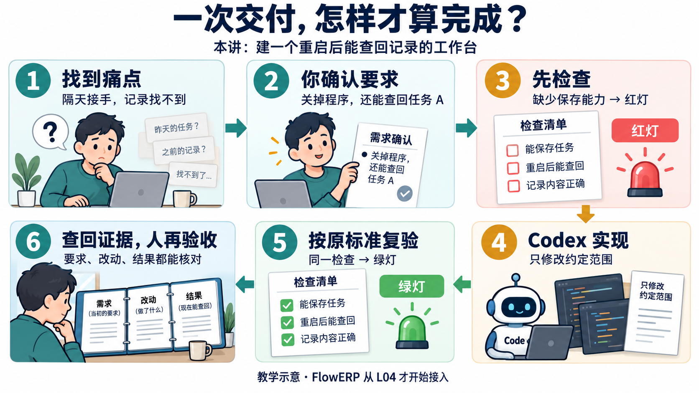
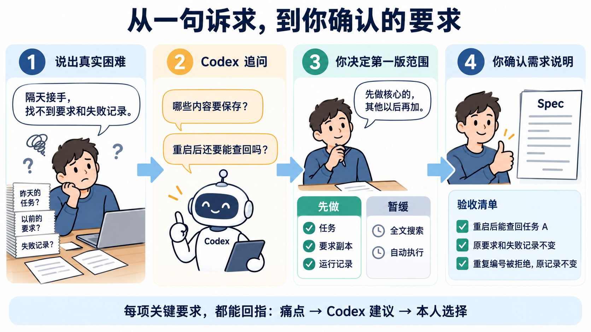
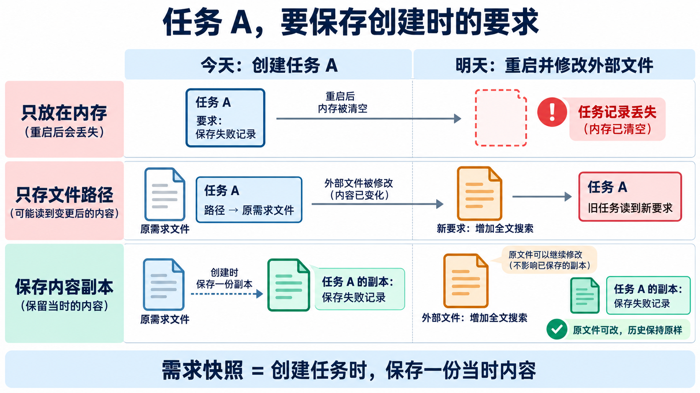
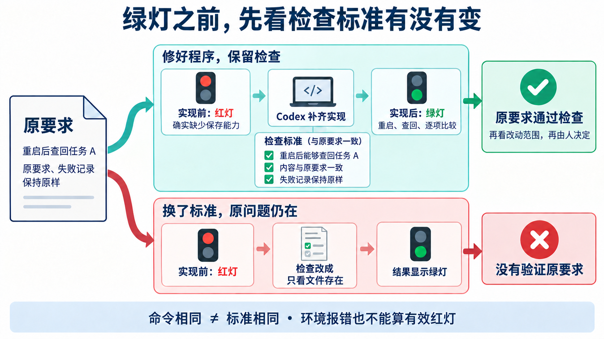
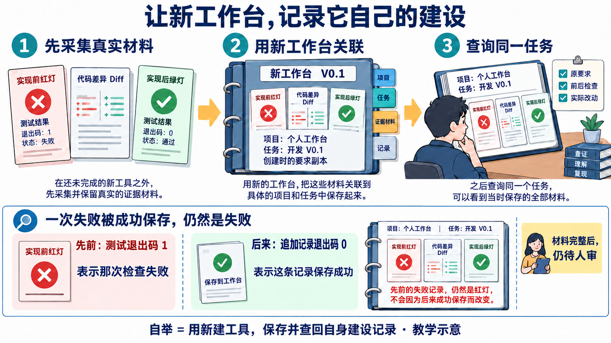

# L01｜以终为始：一次可验证的 AI 交付怎样完成？

昨天请 Codex 做了一个小工具，今天接着做，却找不到原要求和失败记录。**本讲就解决这件事：建一个关掉、重新打开后，仍能查回记录的个人工作台。**

先跟着“任务 A”看图，再去[实践操作手册](实践操作手册.md)动手。图中的 A、红绿灯和结果都是教学示意；你的建设记录需要来自实际操作。

## 1｜先看懂本讲的交付路线

**图 1-1　按编号 1→6 阅读。** 你决定要求和接受理由，Codex 协助提问、写代码和运行检查。第 3、5 步使用同一份检查标准，第 6 步再由人核对证据。

起点是 L00 的工作台壳：已有首页、健康检查和壳测试。本讲在同一个人项目中补齐记录能力，称为 **Workbench V0.1**；V0.1 是建设阶段编号。最终既要有能运行的工具，也要能查回它是怎样建成的。

**FlowERP** 是后续要开发的库存、订单、采购软件，L04 才开始接入。先造出工作台，后续再用它组织人与 Codex 交付客户产品。

## 2｜让 Codex 追问，由你确定第一版做什么

“帮我搭建个人 AI 研发工作台”还不能直接验收。先从真实困难说起，再把范围缩到能检查的一版。

**图 1-2　从左向右看四次变化。** “找不到记录”经过追问，变成“保存哪些内容”；你选择先保存任务、要求副本和运行记录，暂缓全文搜索与自动执行；最后确认重启、内容不变和重复编号拒绝三项检查。

把本人选择及理由写入 `WORKBENCH_SPEC.md`，也就是本次**需求说明（Spec）**，并由你确认签署。它应由本次访谈形成；每项关键要求都能回指“原始痛点 → Codex 建议 → 本人决定”。

**怎样判断写清了？** 请同伴只看 Spec，说出要做什么、比较哪些值。如果他只能说“应该成功”，就继续细化；能说出“重启后查回 A，原要求和失败记录不变”，才有可核对的目标。

## 3｜记录要怎样关联，昨天的要求怎样保住

**图 1-3　沿项目 → 任务 → 运行记录阅读。** 项目是持续开发的对象，如个人工作台；任务是一次有边界的工作，如开发 V0.1；运行记录是一次检查的命令、输出、退出码和时间。退出码是程序结束时给出的结果编号，含义要结合该命令判断。失败后再检查，要追加新记录，才能看到变化。

任务还要保存创建时的要求。为什么只存文件位置不够？看下面三种结果。

**图 1-4　逐行比较“今天”和“明天”。** 第一行重启后丢记录；第二行外部文件改了，旧任务也读到新要求；第三行保存了一份当时内容，外部文件可以继续修改，任务 A 的依据仍保持原样。这份副本叫**需求快照**。

## 4｜把记录变成五个能运行的动作

**持久化**就是关掉程序后，记录仍能恢复。操作位置是个人工作台的终端，即输入命令、查看结果的窗口，按下面顺序建设：

| 动作 | 做完后应能查到什么 |
|---|---|
| 初始化 | 本次工作台身份和数据目录 |
| 登记项目 | 工作台自身的项目身份与源码位置 |
| 创建任务 | 任务 A 的目标和创建时的要求副本 |
| 追加证据 | 实现前红灯、实际代码差异、实现后绿灯及原始退出码 |
| 查询状态 | 同一任务的要求、检查历史和待人审状态 |

保存也要守住边界：重复任务编号被拒绝，旧任务不变；不存在的任务不能追加记录。**报错后还要查一次数据**，确认没有留下半条记录或覆盖原内容。

选读：写代码时，四类职责怎样分工

命令入口接收输入，任务逻辑核对编号与关联，存储负责保存和读回，测试比较约定行为。少量函数和模块即可，位置与理由写入 Spec。

参考实现使用本地 SQLite 数据库，不需要单独服务。一次操作若涉及多处写入，可用事务让它们一起成功或一起撤销；这与“重启后仍能读回”要分别检查。可对照 [`workbench/bootstrap.py`](../../../workbench/bootstrap.py) 的 `create_task()`、`add_evidence()` 和 `status()`，再检查自己的实现。

## 5｜先做能抓住问题的测试，再看红灯变绿灯

**测试**是让程序完成约定动作，再比较实际与预期。沿任务 A 做一项完整检查：

1. 在独立数据目录创建 A，追加一条失败记录，保存当时的需求内容。
2. 结束原程序，修改外部需求文件，再启动新程序，读取同一个数据目录。
3. 查询 A，比较任务编号、需求副本，以及失败记录的命令、输出、退出码；它们应保持原样。

这会抓住图 1-4 的两种错误：只存内存会丢，只存路径会变。另用 A 创建不同内容，应被拒绝，再查询原 A，确认未被覆盖。

**图 1-5　上路修好程序，下路换了标准。** 有效**红灯**表示目标行为确实缺失；实现后按原标准再次检查，叫**复验**。通过时出现**绿灯**。只把检查改成“文件存在”，即使命令相同，也没有验证重启和原内容。

核对前后测试副本，确认原比较项仍运行。解释器找不到、参数拼错或零个用例，都不能证明目标行为失败；若改前已通过，如实调查已有能力。测试确需修订时，确认理由后为新标准重新建立红绿结果，保留旧记录。

## 6｜检查通过后，还要看实际改了什么

**Diff** 是修改前后的代码差异。对照已签署的 Spec，看有没有删掉检查、放宽预期或修改无关目录。绿灯只支持本次检查的结论，接受仍需要人的判断。

| 观察到的问题 | 先查哪里 |
|---|---|
| 重启后查不到 A | 是否使用同一数据目录，是否真正保存 |
| A 能查到，要求却变了 | 是否只存路径，没有保存内容副本 |
| 重复编号报错，原 A 却被修改 | 校验与写入顺序，拒绝后数据是否不变 |
| 测试变绿，重启仍失败 | 测试是否被削弱，原比较项是否运行 |

## 7｜用新工作台，查回它自己的建设

工具尚未建成时，先按[实践操作手册](实践操作手册.md)采集真实命令与输出。建成后，再登记“个人工作台”项目、创建“开发 V0.1”任务，关联原要求、红灯、Diff 和绿灯，然后查询这项任务。

**图 1-6　上半部分看先后顺序，下半部分看两个结果。** 先前测试退出码 `1` 表示那次检查失败；后来追加记录退出码 `0` 表示保存这条记录成功。图中原失败一直保留。这叫**自举**：新工具开始保存并查回它自己的建设记录。

第二天接手时，应能从同一任务回到原要求、实际改动和原始输出，再作判断。这就是**证据优先、可追溯**。成功保存一条观察，仍需打开原始记录核对它支持什么事实。

选读：完整记录、人工验收与后续能力有什么关系

参考程序的 `evidence_complete` 只表示材料满足完整性条件，`acceptance` 仍是待人工审核。账本核对命令、时间与 Diff 的关系，不能自动确认红灯原因、测试充分性或执行者身份。内容哈希是用于比对内容的标识，能帮助发现变化，也不证明记录真实。

FDE 是 Forward-Deployed Engineering 的现场、交付、能力三循环：隔天接手困难促成记录能力，重启查回检验交付，再把有来源、有适用条件的经验用于下一项任务。L01 的账本提供材料；记忆召回和流程复用在后续讲次建设。[原有红绿机制的可编辑图源](assets/reading-depth-20261003/mechanism.drawio)保留供对照。

## 8｜去实践，再换一个任务检验自己

打开[实践操作手册](实践操作手册.md)，在已有个人壳上继续，或使用课程提供的壳建立项目。按访谈、签署 Spec、测试、实现、复验、自举行动；个人记录放在 `lesson-01-submission/`。

**完成判断：** 本人取舍能回指原痛点；原标准红灯 → 范围内 Diff → 绿灯能配对；新工作台能查回自身建设任务和原始证据；你能解释接受或返工理由。详细要求见[手册的目标与通过要求](实践操作手册.md#lesson-goals)。

**迁移任务：** 换成“文档校对”项目。项目、任务、运行记录仍可沿用，但要求副本要保存本次校对依据，验收要检查原文引用和修改范围。请同伴补查一项遗漏，保留反馈与修订；参考程序能运行不能替代你的迁移判断。

下一讲继续使用这个工作台，并把长期协作规则写入 `AGENTS.md`，让新一次 Codex 会话也能遵守约定。

[课程学习路线](../../README.md#16-讲学习路线) · [实践操作手册](实践操作手册.md) · [下一讲](../L02/辅导资料.md)

选读：课程大纲中的本讲要求（原文）

## 课程大纲中的本讲要求

- **核心内容**：个人项目已有 L00 的首页、健康检查和壳测试，尚无本讲的账本能力、已签署的 `WORKBENCH_SPEC.md` 和账本验收测试；学生从一句模糊诉求和真实痛点出发，利用 Codex 完成需求访谈，由学生决定范围并签署首份 Spec，再把验收项转成红灯测试，开发初始化、项目登记、任务账、命令证据账和状态检查。
- **演示结果**：`“帮我搭建个人 AI 研发工作台”` 经历“原始诉求 → Codex 追问 → 学生取舍 → `WORKBENCH_SPEC.md` → 验收测试红灯 → Codex 实现 → 同一测试绿灯”，最后由新工作台记录自己的建设证据。
- **课内增量**：学生亲手形成并签署首份 `WORKBENCH_SPEC.md`、从验收项生成失败测试、开发出可运行的 Workbench V0.1，并完成第一次自举记录；本讲不接入、不开发 FlowERP。
- **通过标准**：Spec 每项关键要求能回指原始痛点、Codex 建议和学生决定；测试能回指验收项；必须保留实现前红灯、范围内 Diff 和实现后绿灯；学生能用自己开发的命令完成自举，并说明 L04 才会通过“个人工作台 + Codex”开发 FlowERP。

选读：后续网页形态与本讲终端账本有什么区别

**后续形态预览。** 这是后续网页形态的参考图（2026-09-05）。先认出项目、任务和验收入口；本讲交付的是终端里的 Workbench V0.1，即初始化、项目登记、任务账、命令证据账和状态查询。L04 的 Workbench V0 另补执行与审核，两个名称表示课程建设阶段。

