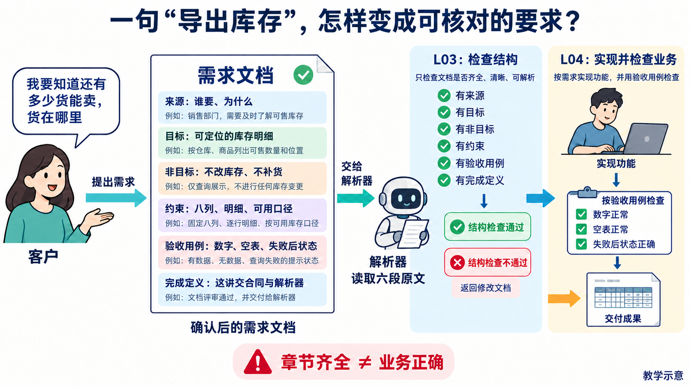
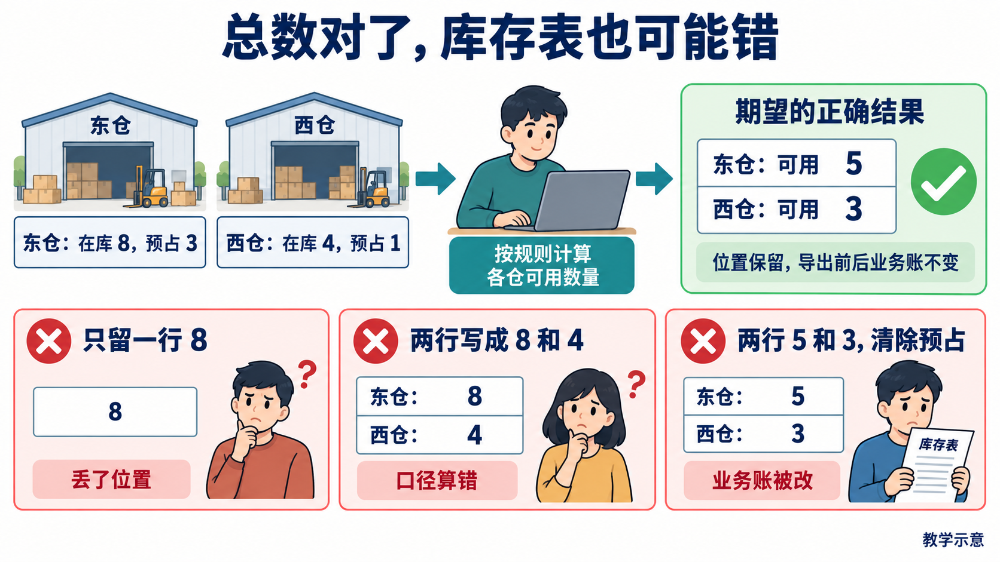

# L03｜把模糊需求变成可验收 Spec

运营说：“导出库存，告诉我还能卖多少，货在哪里。”L01 已写过需求，L02 已固定长期规则；今天把本次取舍整理成可复用的需求说明（Spec），并建设读取六段原文的解析器。你确认业务含义，Codex 协助追问与实现解析；真正的 FlowERP 库存导出留到 L04。

## 先看：把用途写成六段需求说明

[](assets/beginner-visual-guide/01-spec-to-action.png)

**图 3-A　从左向右读。** 来源说谁要、为什么；目标说结果；非目标排除本次不做的事；约束说明口径与允许修改范围；验收用例写输入、动作和预期；完成定义说明交回什么。把决定及理由记入 `decisions.md`，本人确认版写入 `FDE_SPEC.md`。

解析器是读这份文件的小程序。例如，“目标”节写了“导出每个仓位的可用库存”，读回的“目标”正文就应保持这句原文。它检查章节是否齐全，不会自动判断库存公式，也不会替你生成业务测试。

## 用东仓和西仓，把“正确”说到能比较

[](assets/beginner-visual-guide/02-stock-counterexample.png)

**图 3-B　先算上方，再看下方三种反例。** 东仓实际有 8 件，其中 3 件留给已有订单，还能卖 5 件；西仓实际有 4 件，其中 1 件已预留，还能卖 3 件。实际有多少叫“在库”，已预留多少叫“预占”；可用量＝在库－预占。总数虽为 8，找货仍需要两行位置明细；导出也不得改变库存与流水。

先约定一行代表什么：本例每行对应一个商品在某仓库、仓位、批次中的库存，不能把不同位置合成一行。CSV 是保存表格的文本文件。八列依次为商品编号、名称、仓库、仓位、批次、在库、预占、可用量；程序中的名称依次是 `sku,name,site,location,lot_id,on_hand,reserved,available`。

| 验收条件 | 应观察什么 |
|---|---|
| 两仓与打乱输入 | 两行 5、3，位置保留，排序稳定 |
| 空库存、特殊字符 | 八列表头；用 CSV 读取器读回完整字段 |
| 写出中途失败 | 明确报错，原有效文件保留，无可误用半成品 |
| 正常与失败导出 | 前后业务账不变 |

## 解析器要抓住哪些结构错误

<a id="从一段文本看懂解析器怎样工作"></a>

解析器把“来源、目标、非目标、约束、验收用例、完成定义”依次读出。缺章、重复章、顺序错误、空正文或多出不认识的二级标题，都应报明原因。Markdown 用成对的三个反引号围住代码示例，这叫代码围栏；少了结尾也应报错。示例里的标题不能误当正式章节。

先做三份输入：正确合同读回原文；缺章合同报明位置；业务错误但结构完整的合同能解析，再由人退回业务错误。文件读取保持原文，也不启动客户编码。

若正确文件被拒绝，查标题、围栏与空章；若错误公式被解析，先分清检查职责，不把库存公式硬编码进通用解析器。

## 去实践，并交接确认版

**动手入口：** 从手册的[第 1 步：建立本讲目录](实践操作手册.md#第-1-步建立本讲目录)开始。在个人练习仓库建立本讲目录，合同与反例放在同一位置。

按[实践操作手册](实践操作手册.md)经历澄清、V1修订、抽取模板、建设解析器与复验，保留个人决定、局部分工、版本和同伴反证。

**完成判断：** 能用明细、公式、只读状态三类反例检查合同；能解释结构通过为何不保证业务正确；解析入口有真实结果。

**迁移：** 换成采购申请导出，重新确认用途、逐份还是汇总、权限和失败后状态，再沿用六段结构。L04 接收确认合同，先补工作台执行，再交付业务导出。

图中数据和结果均为教学示意，个人证据应来自实际操作。图可点击放大；先看主要箭头和图下注释，再核对细节。

[课程学习路线](../../README.md#16-讲学习路线) · [实践操作手册](实践操作手册.md) · [上一讲](../L02/辅导资料.md) · [下一讲](../L04/辅导资料.md)

## 按需要深入：原理、代码与反例

第一次阅读先掌握上面的案例，并按“动手入口”进入手册。以下按问题查阅：写代码时查实现，遇到异常时查反例；正式合同供逐项核对，无需把所有条目一次展开。

<details>
<summary>选读：先确定用途，才能确定数字的含义
</summary>

## 1｜先确定用途，才能确定数字的含义

需求澄清先问使用者拿结果做什么，再讨论文件格式。运营要知道还能承诺销售多少，以及货在哪里。若现有查询已经满足需要，可以先使用查询；本例确认还需要交接一份明细文件，因此选择建设导出。

商品 A 在东仓有 8 件，其中 3 件已留给订单。这 3 件仍在仓库里，却不能再次分配，称为**预占**；其余 5 件称为**可用**。本例可用量＝在库量－预占量。数字用于教学推演。


**图 3-1　先分清在库、预占和可用。** 若文件只写“库存 8”，使用者可能把不能再次分配的 3 件也当成可售数量。字段名正确，数字含义仍可能错误。

西仓另有在库 4、预占 1，可用 3。合计可用 8 没有算错，但运营还要找货，所以必须保留东仓 5、西仓 3 两条明细。**一行代表什么，叫数据粒度**。本次以商品、仓库、仓位、批次的明细为粒度，不能为了简洁合并成每个商品一行。


**图 3-2　同一商品仍可有多行。** 选择明细付出的代价是文件更长，得到的是位置与批次信息。是否合并取决于使用目的，不是所有导出都必须使用同一种粒度。

把这些取舍记入 `decisions.md`：谁提出、原话是什么、查到了什么、选择哪种口径、为什么放弃另一种方案。客户事实未知时标“待确认”；课堂角色确认要注明练习身份。Codex 可以追问和给建议，业务口径由你确认。

</details>

<details>
<summary>选读：目标、非目标和约束分别回答什么
</summary>

## 2｜目标、非目标和约束分别回答什么

**目标**描述这次完成后使用者能做什么：“得到可定位货物的库存明细文件”。**非目标**排除看似相关、这次却不做的工作：“不发邮件、不自动补货、不修改库存”。**约束**限制完成目标的方法与含义：“按在库减预占计算，复用库存查询，导出成功和失败都不改业务账”。

三者各自必要。只有目标，Codex 可能顺手增加自动补货；只有禁止事项，读者不知道要交付什么；只有约束，仍不知道哪些行为算成功。**最小变更**是在满足完整验收的前提下缩小修改面，而不是只做正常路径、留下错误路径不处理。

沿导出调查三个职责：入口接收参数并核对权限，库存查询提供明细，文件输出处理 CSV 格式与写出失败。**CSV**是以字段和行保存表格的文本格式；逗号、引号、换行需要专门规则，不能简单拼接字符串。


**图 3-3　为本次需求决定局部分工。** 图是职责示意。请 Codex 只读追踪实际入口，你打开引用代码核对；不存在的位置标为拟新增。已有查询能满足要求就复用，避免导出再维护一套库存算法。

设计选择与理由保留在 `decisions.md`，确认后的调用关系、写集和错误处理写进 Spec 的约束。工作台保存客户任务合同，库存仍属于独立 FlowERP。完整结构选读见[库存导出架构选读](reference/参考说明.md)。

### Spec 驱动交付：四层判断接力，才能走到客户结果

**Spec 驱动交付**就是把确认的决定写成合同，让设计、实现和检查依据同一版本推进。本例的四种判断要接力：

| 判断 | 本例要查什么 | 依据在哪里 |
|---|---|---|
| 业务 | 文件用于找货，可用 5 与 3 要保留为两条明细 | 运营用途、确认口径与数字反例 |
| 架构 | 工作台保存任务；独立 FlowERP 的入口、库存查询、文件输出协作 | 实际模块、调用方向、数据归属与设计决定 |
| 结构 | 六节齐全、顺序正确、正文可取出 | 本讲 `parse_spec()` 的原文与结果 |
| 行为 | 实际 CSV 和导出前后业务账符合合同 | L04 同一候选的正常与失败复验 |

先调查平台已有分工，再确定本次导出怎样调用。入口、查询和输出可以在同一应用内；复用已确认查询，避免页面另算一套可用量。六节齐全无法替代这项架构调查。


**图 3-4　四种判断各有对象，确认版 Spec 把它们接起来（教学示意）**

[L02](../L02/辅导资料.md) 的依据筛选继续沿用。从左向右读图，追问每一格由谁、用什么材料确认。写成“导出后清除预占”时，结构仍完整，但业务判断应退回；写成“工作台直接修改客户库存库”时，架构判断要核对数据归属。候选数字算错则由 L04 行为复验发现，修业务实现，不把库存公式硬编码进通用解析器。

</details>

<details>
<summary>选读：把“正确”改成可以反驳的验收项
</summary>

## 3｜把“正确”改成可以反驳的验收项

一项验收用例要包含**准备条件、操作、预期结果和失败后状态**。例如：“东仓在库 8、预占 3，西仓在库 4、预占 1；运行导出，保留两行，可用分别为 5 和 3；导出前后库存及流水不变。”同伴可以据此判断文件里的数字与业务状态。

只写“正确导出库存”不能反驳任何具体错误。“文件存在”也无法发现错误公式或缺失位置。验收项不是再说一遍目标，而是选出能够区分正确与错误方案的输入和比较方法。

沿用同一个导出，再覆盖以下边界：

| 条件 | 预期结果 | 排除的错误方案 |
|---|---|---|
| 多仓、仓位或批次 | 保留明细，按商品、仓库、仓位、批次排序 | 合并后丢失位置，顺序随输入漂移 |
| 没有库存记录 | 生成八列表头，没有数据行 | 空数据时报错或少了列 |
| 中文、逗号、引号、换行 | CSV 读取器读回后字段内容保持完整 | 直接用逗号连接字符串 |
| 写文件中途失败 | 明确报错，原有效文件保留，不留下可被误用的半成品 | 报错同时破坏旧文件 |
| 正常或失败导出 | 库存及流水均不变 | 导出顺手改变业务账 |

八列为 `sku,name,site,location,lot_id,on_hand,reserved,available`，分别表示商品编码、名称、仓库、仓位、批次、在库、预占、可用。完整格式见[库存导出修订样稿](examples/inventory-export-v2.md)。

公式、例子和比较方式需要同时出现。公式可迁移到别的数据，例子使错误容易暴露，比较方式让验收可执行。例如文本比对容易被合法的 CSV 转义误导，读回后逐字段比较更贴近客户要求。

### 总数相同，为什么仍可能交付了错误结果

东仓可用 5、西仓可用 3，合计与合并后再相减都是 8。只查总量无法判断货在哪里。同一输入可以反驳三种不同错误：

设想三个候选实现，以下仅列与推理有关的结果，均为教学反例，没有实际生成业务文件：

| 候选结果 | 哪项检查可能通过 | 必须由哪项验收退回 |
|---|---|---|
| 商品 A 只有一行，可用 8，东、西仓被合并 | 可用总数等于 8 | 商品、仓库、仓位、批次明细保留 |
| 东仓可用 8，西仓可用 4，位置都有 | 两仓、两行和位置检查 | 可用量必须分别为 5 与 3 |
| 东仓可用 5，西仓可用 3，但导出后清除了预占 | 文件字段与数字检查 | 导出前后库存及流水不变 |

三行分别检查**明细有没有丢、公式有没有错、业务账有没有变**。总数、文件存在或列名正确，都不能单独支持接受。


**图 3-4a　用同一组输入反驳三种错误方案。** 这是教学机制示意。上方从东仓 8、3 与西仓 4、1 推到两行 5、3，再核对导出前后状态；反例的合计 8 数学上成立，却丢失了找货需要的位置。[可编辑源图](assets/reading-depth-20261003/mechanism.drawio)。

读图时逐行比数字，再查导出前后的业务账。行数来自实际明细，不能将仓库、仓位、批次数量直接相乘，生成不存在的组合。把“八列、两行 5 和 3、位置与批次保留、正常及失败后业务账不变”签入合同，L04 再对真实候选检查。采购申请迁移题同样先确认逐份还是汇总，不能只看总金额。

</details>

<details>
<summary>选读：把这次决定组织为六段合同
</summary>

## 4｜把这次决定组织为六段合同

课程的 Spec 固定使用六个二级标题，按顺序填写。它们不是六个空框，而是把来源、结果、边界和检查连起来。

| 章节 | 本例要写清什么 |
|---|---|
| 来源 | 运营原话、使用目的、确认人，课堂练习身份和待确认项 |
| 目标 | 导出可定位货物的库存明细 |
| 非目标 | 不发邮件，不自动补货，不修改库存 |
| 约束 | 八列、计算口径、明细粒度、排序、调用分工与允许修改范围 |
| 验收用例 | 两仓数字、空数据、特殊字符、写出失败及业务账不变 |
| 完成定义 | L03 交接确认合同与可用解析器；L04 再验收实际业务导出 |

先保存 V1，再请同伴或 Codex 用反例找歧义。如果 V1 写“每个商品一行”，同伴指出多仓情形，你就必须决定是否保留明细，而不是让模型自行猜。保留原句、修订句与理由，最后确认一份版本交给下一讲。

模板只抽取六节标题和提问方式，不把“在库减预占”写成所有需求的答案。换成采购申请导出，结构可以沿用，字段、权限和业务规则要重新确认。

</details>

<details>
<summary>选读：解析器怎样检查结构，为什么不裁决业务
</summary>

## 5｜解析器怎样检查结构，为什么不裁决业务

**解析器**将文本分成程序能读取的字段。完整合同映射为 `source`、`goal`、`non_goals`、`constraints`、`acceptance`、`done`。它的职责是让后续工作台明确取到哪一段原文。

以两节片段说明切分，片段单独提交仍因缺章而被拒绝：

```markdown
## 目标
导出保留位置的库存明细。
## 非目标
不修改库存，不自动补货。
```

处理时，先识别正式标题的位置，再取相邻标题之间的正文；“目标”的正文止于“非目标”开始处。之后检查六节是否齐全、顺序正确且正文非空。重复标题不能悄悄覆盖，未知二级标题应明确报错。

代码块里可能也有 `## 目标`，但它只是正文示例。解析器需要追踪代码围栏是否打开，只在围栏外识别正式章节；围栏没结束时应拒绝，避免吞掉后面的合同。参考实现 [`workbench/spec.py`](../../../workbench/spec.py) 的 `_contract_headings()` 和 `parse_spec()`承担这些工作，只支持课程合同所用的 Markdown 子集。


**图 3-5　结构有效与业务正确分别检查。** 删掉“非目标”应由程序拒绝；结构齐全却写成可用量＝在库量，仍能解析。人用东仓 8、3 的例子算出 5，才能退回业务错误。图中的相加错误也是同一边界的反例。

由你直接监督 Codex 先写结构测试，再实现并接入工作台入口。三份输入分别验证：正确合同读回原文，缺章合同定位错误，业务错误合同结构通过但人工退回。读文件不能改原文，也不能开始客户业务编码。

若完整文件被拒绝，先核对标题、顺序、空章与围栏；若业务错误被接受，先看你检查的是结构还是业务。给通用解析器硬编码库存公式，会让下一种需求无法复用，不能用扩大解析器职责代替业务审查。

</details>

<details>
<summary>选读：带着确认版进入实践与交接
</summary>

## 6｜带着确认版进入实践与交接

按[实践操作手册](实践操作手册.md)完成六步：建立记录、回答需求问题、形成 V1 并修订、抽取模板、建设解析器、用三份输入复验。个人材料在 `lesson-03-submission/`，保留自己的判断、局部分工、Spec 版本、真实检查与同伴反馈，完成要求见[手册中的目标与通过要求](实践操作手册.md#lesson-goals)。

迁移练习仍是“采购申请导出”。请重新说明使用目的、一行代表什么、谁有权限、失败后保留什么，再套用六段结构。能解释为何库存例保留两行、解析通过仍会退回，以及哪些规则不能搬到采购例，才证明你会使用 Spec。

本讲应交接确认版 `FDE_SPEC.md`、设计依据、模板与已接入的结构检查入口。L04 先补齐执行工作台，再根据这份合同交付导出；合同结构通过与客户结果合格各有自己的证据。

</details>

<details>
<summary>选读：课程合同原文与配套入口
</summary>

## 课程大纲中的本讲要求

- **核心内容**：目标与非目标、正常与错误路径、边界条件、可执行验收项、最小变更原则。
- **演示结果**：把“增加导出功能”拆成结构化 `FDE_SPEC.md`。
- **课内增量**：由学生在外循环直接监督 Codex 实现 Spec 模板与最小解析器，只生成和校验合同结构，不执行 FlowERP 业务编码。
- **通过标准**：Spec 至少包含目标、非目标、约束、验收用例和来源；缺失必要字段时返回明确错误。

</details>
