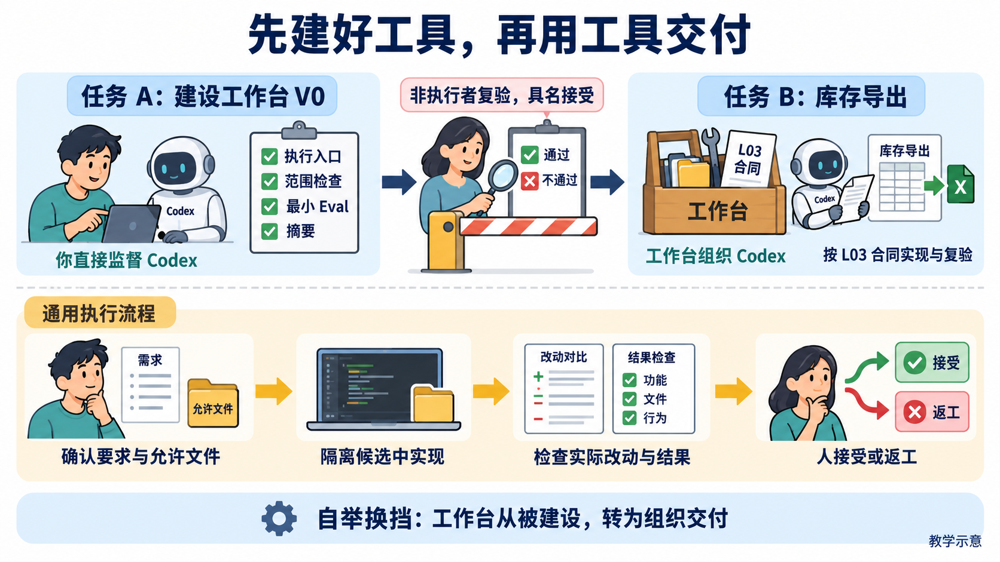
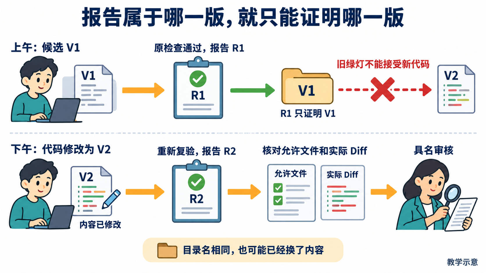
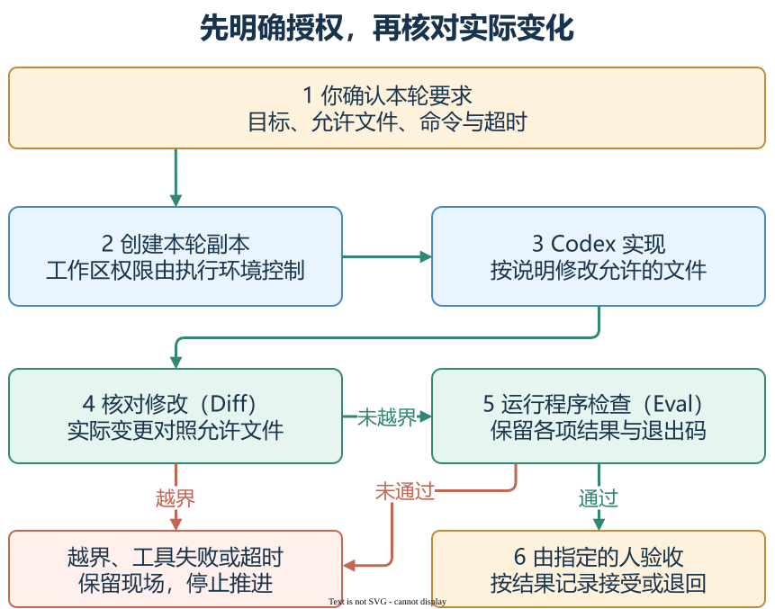

# L04｜委托 Codex 执行一次最小变更

L03 已确认库存导出合同，但工作台还需要执行和收回结果的能力。本讲先建设工具，再用它交付 FlowERP；两个任务都要有各自的实际检查与人审依据。

## 先看：A 建工具，B 才交付客户

[](assets/beginner-visual-guide/01-build-then-deliver.png)

**图 4-A　必须先跨过中间的人审。** 任务单（Ticket）A 先补齐四项能力：调用 Codex、核对改动范围、运行质量检查（Eval）、生成结果摘要。另一位没有参与实施的人实际复验，并记录姓名和接受理由后，任务单 B 才开始库存导出。工作台由此开始组织人与 Codex 交付客户产品，这一步称为**自举换挡**。

从工作台根首页“事项与决策”开始，日常地址为 `http://127.0.0.1:8001/`。客户业务仍在独立 FlowERP，源码和数据目录分别管理。

<a id="一份委托怎样变成一次受控执行"></a>

## 每次委托，先说清三个位置

| 名称 | 需要确认什么 |
|---|---|
| 工作目录 | 实际从哪里运行、加载哪份代码 |
| 隔离候选 | 从明确版本复制出的本次工作副本；修改和检查都在这里进行 |
| 写集 | 本次允许修改的文件清单；超出清单须重新确认 |

在候选中调用 Codex，收回实际命令、输出、时间、退出状态和代码差异（Diff），运行质量检查（Eval），形成待人审摘要。程序提交任务、等待结果而无需逐句输入，叫非交互执行。

改完后比较 Diff，能发现最终改动是否越界，却不等于程序一开始就无法写入其他文件。执行超时也可能留下部分改动：先停止执行并保存现场，再决定恢复或检查。调用退出码为 0 只说明这次调用正常结束，CSV 算错仍须返工。

## 再看：旧报告为什么不能接受新代码

[](assets/beginner-visual-guide/02-current-evidence.png)

**图 4-B　追清 V1、V2 与各自报告。** 目录没变，内容也可能变了。新代码需要新复验；若改变的是工作台执行机制，回到 A 重新确认，不能沿用旧 A 继续 B。

B 复验使用同一合同与候选：东仓在库 8、预占 3，可用 5；西仓在库 12、预占 4，可用 8。核对八列、明细排序、特殊字符、空表、写出失败保护，以及导出前后业务账不变。即使业务检查通过，若未经允许修改采购页面，交付仍不合格。

## 去实践：按 A、B 顺序交回证据

**动手入口：** 从手册的[第 1 步：建立本讲证据区](实践操作手册.md#第-1-步建立本讲证据区)开始。先建立 A、B 的记录文件，再按顺序建设与验收。

按[实践操作手册](实践操作手册.md)先建设并独立验收 A，再交付和复验 B。人审记录姓名、具体候选、依据、接受或返工理由；没有实际复验者就保留待办。

**完成判断：** A 实际调用、失败、超时、越界和待审核路径都有证据；B 有自己的正常与失败复验；摘要列出修改文件、实际命令和剩余风险。保留失败，不提交密钥、环境文件或运行库。

**迁移：** 给 CSV 增加采购成本列，先确认来源、权限和新验收，再改合同与写集。可复用受控机制，旧导出绿报告仍需更新。L05 接着检验这些检查能不能稳定抓错。

图中数据和结果均为教学示意，个人证据应来自实际操作。图可点击放大；先看主要箭头和图下注释，再核对细节。

[课程学习路线](../../README.md#16-讲学习路线) · [实践操作手册](实践操作手册.md) · [上一讲](../L03/辅导资料.md) · [下一讲](../L05/辅导资料.md)

## 按需要深入：原理、代码与反例

第一次阅读先掌握上面的案例，并按“动手入口”进入手册。以下按问题查阅：写代码时查实现，遇到异常时查反例；正式合同供逐项核对，无需把所有条目一次展开。

<details>
<summary>选读：执行能力由哪些环节组成
</summary>

## 1｜执行能力由哪些环节组成

L01 提供记录，L02 提供规则，L03 提供合同与解析器。V0 要把它们连成一条可以核对的路径：读取确认合同，确定候选工作目录和授权，调用 Codex，收回实际结果，检查改动范围，运行最小 Eval，形成摘要并等待人工审核。


**图 4-1　先建设并接受 A，再执行 B。** 中间箭头的前提是 A 已由非执行者复验并接受。A 的检查通过不表示库存导出已经实现，B 需要自己的证据。

沿箭头核对 A 新增的能力：是否实际调用 Codex、工具失败能否留下结果、改动是否在允许文件内、检查后是否等待人审。每个环节都要有自己的观察。

A 的验收因此要覆盖正常调用、工具失败、超时、越界和待审核状态。先保存实现前缺口，再由 Codex 在授权范围补齐已有实现缺少的环节。参考仓库已有能力可以复验，学生自己缺少的能力才需要建设。具体操作见手册第 1～4 步。

</details>

<details>
<summary>选读：工作目录、候选和写集怎样共同限定任务
</summary>

## 2｜工作目录、候选和写集怎样共同限定任务

**工作目录**决定程序从哪里读取代码与相对路径；**候选**是本次准备修改和检查、尚未接受的代码副本；**写集**是这一任务允许修改的文件清单。它们分别回答“在哪执行”“检查哪版”“允许改哪里”。目录正确不表示其中任意文件都已授权。


**图 4-2　控制、客户源码与候选分开。** 控制工作区保存工作台规则和任务记录，独立 FlowERP 仓库提供客户源码，候选承担本次实现与复验。图中路径是职责示意，需换成实际调查位置。

B 接收 L03 确认版 Spec，并关联已接受的 A 版本。候选创建后记录 Spec 的内容哈希与实际起点，确认实际入口、库存查询和 CSV 输出职责，再选出足以完成验收的最小写集。新增采购页面不属于导出范围；确需增加文件，应交回理由和影响，重新确认后才能继续。

这组约定在课程中称为**能力信封**：一次执行可用的目录、文件、命令、时间和停止条件。提示词说明本轮授权写集；工作区权限由执行环境控制；执行后的 Diff 再核对实际修改是否越界。写集描述允许修改的文件，不能据此推断程序只能读取这些文件。参考执行器使用工作区权限并核对文件变化，不应把逐文件事后检查描述成事前阻止了所有写入。

在 [`workbench/execution.py`](../../../workbench/execution.py) 中可查看 `validate_v0_authorization()`、`normalize_write_scope()` 和 `CodexExecutionRunner`。学生复验应检查自己的入口是否实际使用这些控制或等价能力，而不仅是摘要中写了“范围受控”。

### 分层自主权：可以继续哪些动作，由哪些证据决定

“让 Codex 自动做完”需要先拆成具体动作。**分层自主权**按任务阶段决定它可以调查、修改、检查还是提出接受建议；推进依据是明确授权与实际结果。只读调查库存查询入口，无需因此获得改库存算法的权限；允许修改 CSV 输出，也不能推出允许重写验收标准。这里的分层是本课的设计方法，不是某个产品按钮的名称。

| 当前阶段 | 可以继续什么 | 怎样交给下一位 |
|---|---|---|
| 只读调查 | 追踪入口、说明缺口 | 由你确认合同与写集 |
| 授权编码 | 在候选中实现、运行诊断 | 超时、工具失败或越界时停下，保留已发生的变化 |
| 独立复验 | 对同一候选运行约定检查 | 实际复验者交回结果，由具名审核者决定接受或返工 |

这些执行周围的控制称为 **Harness**：组织合同、调用、边界、结果与审核。L04 先连通最小路径；L06 再专门建设统一分级与报告。Codex 内部可以反复调用工具，外部仍以当前授权和停止条件决定是否继续。



**图 4-3　先确认允许做什么，再核对实际做了什么。** 本轮副本也叫隔离候选，用于实现和检查；执行环境控制工作区权限，实际修改对照（Diff）再核对是否只改了允许的文件。越界或检查未通过就停下、保留结果；通过后仍由指定的人决定接受或退回。这是 L04 目标路径示意，能力是否成立须用本人的正常与失败记录证明。[可编辑源图](assets/control-boundaries.drawio)。

沿图考虑一种越界：断言预期为 5，Codex 将它改为 8。文件可能仍在写集内，但动作改变了合同判据。因此允许文件还需配合动作目的；原合同修复可继续，合同修订须说明理由并确认。L01 的测试快照方法继续沿用，L05 再建设专门的工程约束 Eval。

</details>

<details>
<summary>选读：非交互执行怎样变成可核对的记录
</summary>

## 3｜非交互执行怎样变成可核对的记录

**非交互执行**是由程序提交一次明确任务并等待结果，不依赖你逐句输入“继续”。它适合工作台调用，但仍要预先确定授权、超时与失败处理。执行不会因此免除人的责任。

截至 2026-10-01 核对的 [OpenAI 非交互模式文档](https://learn.chatgpt.com/docs/non-interactive-mode)将 `codex exec` 用于脚本调用。普通模式的过程输出与最终消息需要分别采集，JSON 模式可记录事件。具体命令由工作台执行器构造，学生通过手册入口使用并核对调用证据。

工作台应保存本次 Spec、候选起点、实际命令、输出、退出状态、时间、Diff 与 Eval 报告。超时前可能已写了一部分文件，所以“停止”不等于“自动恢复”。先终止并确认相关执行已停，再保存差异，核对候选状态，决定修订或恢复；不能在未知状态下继续推进。

下面是委托信息的教学示意，方括号必须用调查结果替换；它不是可直接提交的 API 格式或执行记录：

```text
依据：[L03 确认版 Spec 的路径与内容标识]
目标：导出八列库存明细，成功和失败均不改变库存。
执行位置：[隔离候选的绝对路径与起点版本]
允许修改：[已确认的具体实现与测试文件]
模式：Codex 实现；只运行检查不能代替本次编码。
复验：[候选中实际可运行的导出验收与回归命令]
停止：超时、工具失败或越界时停止推进，保留输出和已发生改动。
交回：调用记录、Diff、命令结果、Eval 报告与待审核摘要。
```

例如调用退出 0，但 CSV 把在库 8、预占 3 的可用量写成 8。调用结果是“正常结束”，业务结果是“检查失败”。退出码首先说明哪一个程序怎样结束，不能把执行器成功直接当成客户结果正确。这就是要采集分项结果的原因。

</details>

<details>
<summary>选读：让库存导出同时接受业务和工程检查
</summary>

## 4｜让库存导出同时接受业务和工程检查

L03 已确定八列、明细、排序和可用公式。手册复验将西仓换为在库 12、预占 4，检查同一规则能否得到 8；东仓仍为在库 8、预占 3，可用 5。以下是教学预期：

```csv
sku,name,site,location,lot_id,on_hand,reserved,available
A,示例商品,东仓,E01,L01,8,3,5
A,示例商品,西仓,W01,L01,12,4,8
```

运行实际导出后，用 CSV 读取器比较列名与字段，不只看文件存在；再检查打乱输入仍按约定排序、空库存只有八列表头、中文和特殊字符可读回。导出前后查询库存和流水，确认只读行为。

写出失败也需要设计。本次合同要求原有效文件保留、不暴露半成品，一种方案是先写同目录临时文件，写成后替换目标；失败时清理临时文件。方案必须由实际正常与失败测试证明，不能只看代码中出现了临时文件名。业务账仍不得变化。

最后把同一候选的 Diff 与写集比较。CSV 正确，却改了无关采购页面，工程约束仍不合格；没有代码改动却只做了复验，也不能充当新功能交付。业务正确性、修改范围和材料完整性应分别报告。

</details>

<details>
<summary>选读：报告绑定哪一版，人就审核哪一版
</summary>

## 5｜报告绑定哪一版，人就审核哪一版


**图 4-4　检查通过后进入待审核。** 复验者需要同一份合同、同一候选、实际 Diff 和报告，再决定接受、打回或依据不足。

上午的报告只支持上午检查的代码。下午又改了排序，旧报告可以留作历史，但需要为新候选重新检查。把 Spec、源码版本或内容标识与报告关联，可以防止“拿旧绿灯批准新代码”。

### “仍是同一个目录”，为什么不足以继续接受

上午的 B 通过排序检查，下午排序代码变了，目录名、任务编号和报告却没有变。旧报告仍然真实，支持的是上午的源码；下午的结果需要重新查。审核应对应确认版 Spec、源码内容、复验命令与报告，不能只看目录地址或 JSON 中的 `pass`。

| 变化发生在哪里 | 旧结论还能说明什么 | 应怎样继续 |
|---|---|---|
| B 候选的排序实现变化 | 旧 B 在旧版本上通过 | 留下新 Diff，对当前 B 重新复验，再作决定 |
| B 的 Spec 增加采购成本列 | 旧合同内的导出曾通过 | 确认数据、权限和新写集；建立新候选与报告 |
| A 接受后，控制仓库执行源码变化 | 旧 A 的执行机制曾被接受 | 暂停 B，新建 A 并重新独立复验 |

根据变化选择返工对象：客户输出变了，查 B；委托机制变了，重新确认 A。工作台如实记下 CSV 失败时，应修导出；漏记失败时，应先修控制。


**图 4-5　旧绿灯只能支持被检查过的版本。** 这是教学机制示意。沿合同、候选、复验报告到具名决定阅读；反例中目录未变而源码已变，完成判断要求重新核对内容。迁移部分提醒：A 的执行源码变化和 B 的业务变化，要回到各自的复验对象。[可编辑源图](assets/reading-depth-20261003/mechanism.drawio)。

读图时先找报告属于谁，再找现在要接受谁。参考通用项目报告的 [`report_view()`](../../../workbench/eval_harness.py) 会同时比较当前候选源码内容标识和报告文件摘要；两者一致才标 `current`，不一致为 `stale`。没有绑定信息的历史报告为 `unverified`，读取不到则为 `unavailable`。这些状态说明证据是否仍对应当前对象，`current` 仍不表示已经由人接受。自己的 L04 入口是否提供同样信息，需要实际核对，不能仅凭参考函数宣称本轮已自动拦截。

人的决定要记录姓名、候选、依据和理由，核对目标、失败后状态、修改范围及未验证项。参考 `TaskStore.review()` 保存决定；姓名字段不能代替实际复验。手册第 7 步为返工建立新候选与报告，保留旧任务。

Ticket A 由你直接监督建设，Ticket B 才由已接受工作台组织。从首页使用时，入口是工作台 `http://127.0.0.1:8001/` 的“事项与决策”；客户业务界面与数据库留在独立 FlowERP。

<details>
<summary>遇到“候选已通过，课程复验仍失败”时，再核对这张图</summary>

### 交付通过，为什么课程复验还会失败？

任务复验可能读隔离候选 V2，课程复验读源项目 V1。同一个 `runtime-dir` 只表示任务数据位置相同，不表示检查了同一份代码。


**对照图　先对齐对象、版本和检查条件。** 这是教学假设场景；图中 L12 审批用于举例，本讲仍只交付库存导出。分别查报告的源码目录、内容标识和用例：候选获接受但未集成时，源项目仍须另行检查；同一版本在相同条件下真实报红时，处理实际缺口。Eval 通过、候选接受、集成和部署各有对应证据。

</details>

</details>

<details>
<summary>选读：按 A、B 顺序实践，再用新要求检验判断
</summary>

## 6｜按 A、B 顺序实践，再用新要求检验判断

打开[实践操作手册](实践操作手册.md)：第 1～3 步建设 A，第 4 步非执行者复验并接受 A，第 5 步才执行 B，第 6～7 步独立复验导出并记录决定。摘要交回版本、实际改动、命令结果、审核依据和剩余风险，保留失败，不提交密钥、环境文件或运行数据库。

迁移题是给 CSV 增加采购成本列。它影响 B 的业务合同：先确认数据来源、查看权限和新验收，更新 Spec 与写集后才能执行。A 的受控机制可以沿用，但旧导出报告不能证明新列合格。请同伴核对你把哪些约定复用、哪些重新确认。

本讲应交出已被独立接受的 V0 与有自身复验和人审依据的库存导出。L05 在同一交付路径增加收货时，还要验证检查能够稳定识别错误版本。

[交付机制与故障选读](reference/参考说明.md) · [原有总览图](assets/lesson-overview.png) · [教师执行记录](assets/execution/README.md) · [正文图设计](assets/reading-figures-v1/设计与提示词.md)

</details>

<details>
<summary>选读：课程合同原文与配套入口
</summary>

## 课程大纲中的本讲要求

- **核心内容**：非交互执行、工作目录、权限边界、结果采集与人工确认点。
- **演示结果**：读取第 3 讲 Spec，委托 Codex 完成一个小型代码变更并运行测试。
- **课内增量**：先由学生直接监督 Codex 补齐并独立验收 Workbench V0 的执行入口、写集检查、最小 Eval 和结果摘要，再由 V0 在授权工作区调用 Codex 交付库存导出；不额外包装为文件读写 MCP。
- **通过标准**：变更能够运行；基础测试通过；摘要包含修改文件、验证命令和剩余风险；密钥和环境文件未提交。

</details>
