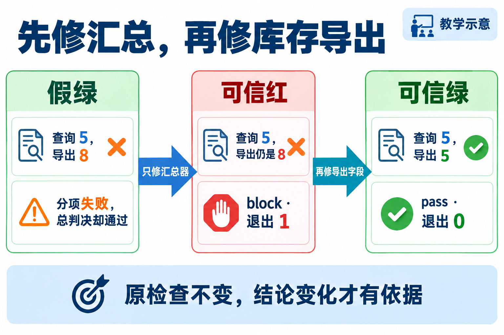

# L06｜用 Harness 汇总证据和等级

检查明明发现错误，最后一行为什么还写“通过”？本讲先修工作台的结果汇总，再修库存导出；分开做，才能看清究竟是哪一处修好了。

组织多项检查、保存各项结果并给出总结的程序，叫检查运行器（Harness）。本例库存 8 件、已留给订单 3 件，查询和导出都应显示还能用 5 件。

FlowERP 在库 8、预占 3，查询可用 5，CSV 却为 8。库存检查已经发现错误，坏汇总器仍报通过。你先让汇总器如实报红，再让 Codex 修导出；这两次修改要分开验。

读图时盯住中间一站：**业务仍红，汇总器已修好。** 最终留下四项清单、分级 JSON、真实退出码，以及统一库存口径的候选。L07 接着用这个入口解决“最后一次修改后忘了检查”。

按这条顺序完成，不需要先浏览所有附件：

1. [辅导资料](辅导资料.md)：理解本次现场问题、要求和判断依据。
2. [实践操作手册](实践操作手册.md)：从自己的来源准备候选，按步骤运行、修复和复验；目标、合同及 Codex 提示词都在对应步骤内。
3. [SUBMISSION：个人证据索引](SUBMISSION.md)：从首次判断开始关联已有记录，提交实际失败、Diff、复验与具名决定；未做项如实标待完成。

[唯一当前课件](L06-用Harness汇总证据和等级-Harness与FDE讲义同步版-36页.pptx)：采用既有 36 页 Harness 与 FDE 讲义同步版。本轮未重验 PPT 内容，命令与完成标准按当前手册。

附件随手册使用：[examples](examples/) 保留脚本与 Skill，[assets](assets/README.md) 保留配图和来源。商品导入属于课后选读，独立 session 与旧报告不混入库存主线。需要深入机制或历史版本时查[参考说明](reference/参考说明.md)，归档稿不构成另一条必做路线。

卡住时先看[手册第 8 节](实践操作手册.md#8中断恢复与失败处理)：分项红而摘要绿查汇总；无法运行查环境；最终证据使用自己的运行记录。

[课程总入口](../../README.md) · [上一讲](../L05/README.md) · [下一讲](../L07/README.md)
