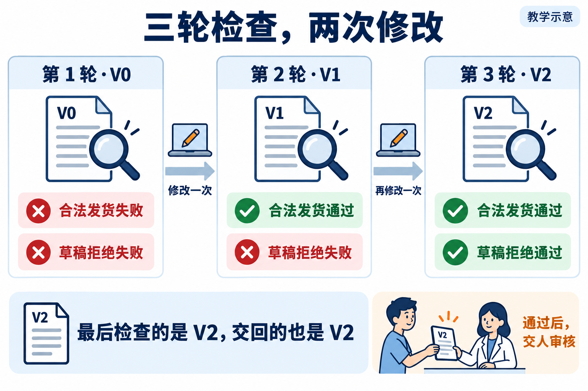

# L10｜建立有停止条件的修复 Loop

Codex 改过一次，检查仍失败，要再改还是停下调查？本讲让工作台按事先确认的范围、轮数和预算安排返工，避免一直改下去，也避免改完最后一版却没有检查。

“检查 → 修复 → 再检查”的循环叫 Loop。订单发货是本讲的业务例子：该发货的成功，不该发货的拒绝，另一张订单的货仍要保留。

图里按检查数轮次：最多三轮检查，最多两次修改，每次修改都留出后置检查。自己的运行可以收敛，也可以带着失败安全停止；两种结果都要说明最新代码与最后有效报告。L11 再讨论哪些工作能并行，仍沿用这里的停止规则。

## 按这条路线学习

1. [辅导资料](辅导资料.md)：读懂现场问题、机制和判断依据。
2. [实践操作手册](实践操作手册.md#lesson-goals)：目标、操作、完整提示词、失败处理与完成判断在同一份手册。
3. [提交模板](SUBMISSION.md)：从首次判断开始，保存本人失败、修订、复验和迁移证据。

**操作路线：** 固定发货要求和红起点 → 只建设 Loop 与检查 → 从已建好候选复制同版两副本 → 确认各自业务范围 → 真实修复收敛／一轮检查后零编码停止 → 同伴复验与迁移。

第一阶段保留发货缺陷，验证新 Loop 的接线；第二阶段才让该 Loop 组织实际业务修复。控制替身和预设补丁在手册的参考观察中，不作为个人真实修复结果。

按手册完成当前步骤，再进入下一步；参考程序与旧报告支持机制观察，个人达成须有自己的任务、候选和实际记录。

## 需要时再打开

- [当前课堂 PPT](L10-建立有停止条件的修复Loop-主线自学版-29页-定稿.pptx)：本讲唯一当前课件。
- [按问题查阅的参考说明](reference/参考说明.md)：深入机制、实现边界及历史证据索引。
- [实验与辅助工具](examples/)：仅在手册对应步骤调用，保留原脚本和数据目录。
- [审查与复用 Skill](examples/skills/)：辅助反证与迁移，不能替代真实复验者的决定。
- [历史归档](reference/archive/)：旧行动卡、提示词、完整参考与旧课件，首次学习无需逐份阅读。

[课程总入口](../../README.md) · [上一讲](../L09/README.md) · [下一讲](../L11/README.md)
