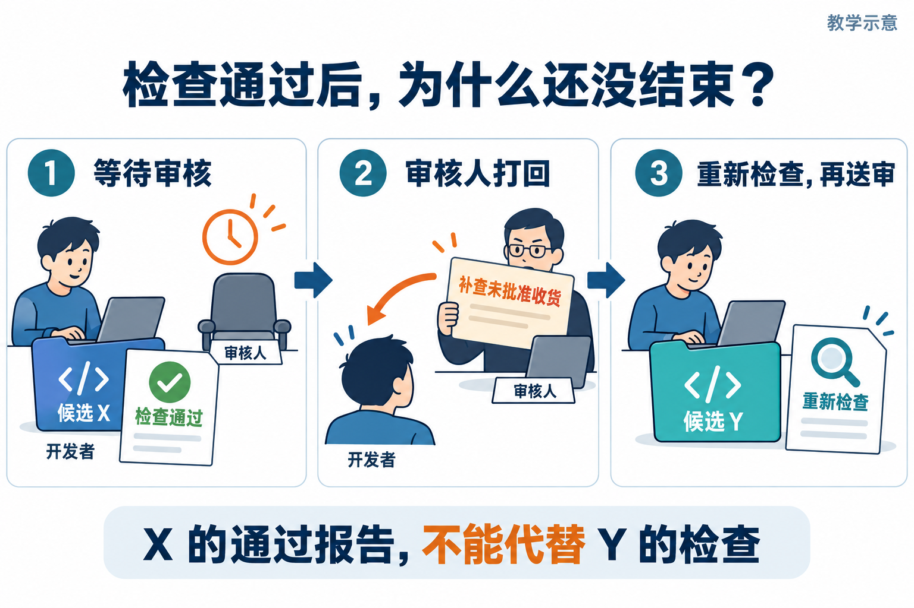
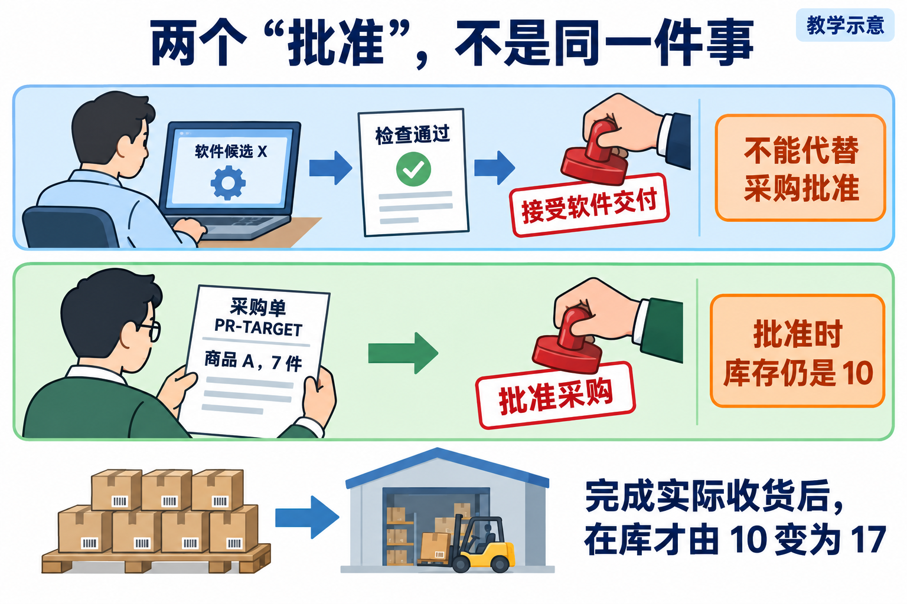

# L12｜用 Graph 显式表达状态、回退和人工审核

先分清软件验收和采购批准，再练等待、退回与恢复。Graph 是规定当前阶段及下一步的状态图；X、Y 表示前后两份待审代码，旧报告不能自动证明新代码正确。

从下面的目标和步骤继续。每次先读本步要做什么、预期看到什么，再执行；没有达到本步完成标志，就保留结果并按本步排错。第一次分不清对话、命令或文件时，查[操作位置与结果怎么读](../../reference/实操手册执行与排错.md#first-operation)。

> **终端选择：** 本手册同时提供 Windows PowerShell 与 macOS 默认终端 zsh 的操作。每一步只运行自己系统对应的代码块；标为“通用”的 Python、Git 命令两端相同。开始或重开终端时，先按[macOS 环境与路径约定](../../reference/实操手册执行与排错.md#macos-zsh)恢复本讲使用的虚拟环境，再核对当前源码位置。

这次交付在 L11 的采购申请之后增加“具名批准、实际收货”。你还要让工作台在软件检查通过后等待审核，打回后形成新候选，重启后查回原状态。**本讲先练清两项决定，再实现等待、打回与恢复。**

第一部分的三条命令各自使用独立实验状态：Graph 等人、采购批准后收货、原业务键重试。第二部分从你自己的候选开始，把这些规则落实到真实交付。两个部分的结果分别记录。

<a id="lesson-goals"></a>

## 本讲目标与完成判断

**版本核对：** 以本次准备命令返回的副本路径、起点版本和实际加载的程序文件为准。

<details>
<summary>来源有疑问时再看：课程标签副本与双仓快照的区别</summary>

`course-submit --execute-code` 从固定起始标签创建 Git Worktree；`course-prepare --source working-tree` 的当前源快照才组合独立 FlowERP 并写 `.course/product-source.json`。以本次 Task ID、返回候选路径、基线和实际模块路径核对；标签没有来源元数据时将客户来源与哈希标为待核对，不把目录名或元数据缺失单独当作候选无效。

</details>

学生定义允许转移和恢复条件，Codex 协助实现与复验；交付审核人决定软件候选，业务审批人决定具体采购单。

| 建设对象 | 本讲目标与因果关系 |
|---|---|
| 工作台 | 用共享状态和显式边组织开发、检查、等待、打回、恢复与有上限停止，保留真实动作和人审。 |
| FlowERP | 采购经具名批准后入库，未批准拒绝，单据、库存和流水一致，同键重试不重复生效。 |
| 学生证据 | 能解释每条允许和拒绝的边，真实打回后检查新候选，重启后核对原决定，并区分软件接受与采购批准。 |

**交付前核对：**

- 每条状态边可回查输入、真实动作和输出；develop 标签不能替代实际受控执行。
- 等待和恢复使用同一候选与有效报告，真实审核绑定对象；采购批准与交付接受分别记录。
- 拒绝、正常入库、同键重放、部分写入及键冲突在同一候选复验；读取和保存异常明确交接。

<details>
<summary>交付前逐项核对：课程四项合同原文</summary>

**课程四项合同：**

- **核心内容**：共享状态、条件分支、审核打回、异常路径和人工介入；原生 Subagents 与外部编排框架的边界。
- **演示结果**：开发 → 测试 → 审核；审核失败回到开发，关键决策等待人工确认。
- **课内增量**：用最小 Python 状态图实现移交、回退、状态保存和审核结论。
- **通过标准**：状态变化可追踪；审核结果来自 Eval；循环有上限；异常不会被静默忽略。

</details>


## 开始前只确认三件事

### 1. 在哪里操作

打开终端，进入 CodexFDE 控制仓库：

**Windows（PowerShell）：**

```powershell
# 换成你自己的 CodexFDE 控制仓库路径
Set-Location 'D:\work\CodexFDE'
$l12Control = (Get-Location).Path
$controlPython = (Resolve-Path '.venv/Scripts/python.exe').Path
```

**macOS（zsh）：**

```zsh
# 换成你自己的 CodexFDE 控制仓库路径；下例是 L00 的默认位置
prepare_l12_control() {
  cd "$HOME/work/CodexFDE" || return 1
  l12Control="$PWD"
  controlPython="$PWD/.venv/bin/python"
  if [ ! -x "$controlPython" ]; then
    printf '请先恢复当前控制仓库的虚拟环境。\n'
    return 1
  fi
}
prepare_l12_control
```

后面的命令都在这个窗口运行。不要切换到系统 Python，也不要先进入 FlowERP 目录；实验程序会在需要时调用独立 FlowERP 环境。

### 2. 怎样判断项目环境可用

运行：

**Windows（PowerShell）：**

```powershell
.\.venv\Scripts\python.exe -X utf8 -m workbench.cli course-contract --lesson 12
```

**macOS（zsh）：**

```zsh
./.venv/bin/python -X utf8 -m workbench.cli course-contract --lesson 12
```

正确结果：命令能显示 L12 的标题、内容和通过标准。

如果提示找不到 `.venv` 或 Python，先停止操作，按[执行与排错说明](../../reference/实操手册执行与排错.md)修复课程环境。不要改用系统 Python 硬跑。

### 3. 先认识四个词

| 手册中的词 | 本讲中的含义 |
|---|---|
| Graph | 管理“下一步去哪里”的程序 |
| Eval | 自动检查程序是否达到要求 |
| 软件审核 | 真人决定这一版程序能不能交付 |
| 采购批准 | 采购负责人决定这张采购申请能不能执行 |

软件审核和采购批准是两个不同决定。软件检查全绿，也不能替采购负责人批准买货。

---

## 第一部分｜第一次跑通

这一部分只观察课程已经准备好的三个独立实验。Graph 实验使用合成检查报告，两个采购实验各自创建临时业务库；后一个命令不会接续前一个命令的状态。它们帮助你分清软件审核和采购批准，**不代表你已经完成自己的 L12 作品。**

## 第 1 步：让 Graph 停下来等人

### 在哪里操作

仍在前面已进入控制仓库的终端窗口。

### 输入什么

**Windows（PowerShell）：**

```powershell
.\.venv\Scripts\python.exe -X utf8 docs/courses/L12/examples/graph_control_lab.py wait
```

**macOS（zsh）：**

```zsh
./.venv/bin/python -X utf8 docs/courses/L12/examples/graph_control_lab.py wait
```

### 应该看到什么

输出很长，不需要逐字看。先找这三处：

```text
"status": "awaiting_human_review"
"from": "develop", "to": "test"
"from": "test", "to": "human_review"
```

它们表示：Graph 轨迹经过 `develop → test → human_review`，收到通过的检查报告后停在“等待软件审核”。本参考实验使用合成报告，`develop` 未实际调用 Codex 修改代码；真实受控执行及其报告要在第二部分的个人候选中证明。

### 如果没有看到

- 提示找不到文件：确认当前位置是自己的 CodexFDE 控制仓库。
- 提示找不到 Python：Windows 确认使用 `.\.venv\Scripts\python.exe`，macOS 确认使用 `./.venv/bin/python`；不要改用系统解释器。
- 出现 `status: failed`：保留完整输出，不要把它改写成成功；先查看其中的 `error`。

### 本步完成标志

你能用自己的话说出：**自动检查通过以后，Graph 仍然会停下来等人。**



先对照左格理解刚才的等待结果；中格与右格用于预测正式交付中的打回路线。X 换成 Y 后，报告也必须重新产生。图为教学示意，刚才的 `wait` 实验只验证等待，没有发生图中的真实软件开发或人审。

## 第 2 步：观察“批准后入库”



沿三层看对象：上层接受软件候选；中层批准采购单，在库仍为 10；下层收到 7 件并登记，库存才成为 17。下一条命令观察独立的业务实验，不使用前一步的 Graph 决定。图为教学示意。

### 输入什么

**Windows（PowerShell）：**

```powershell
.\.venv\Scripts\python.exe -X utf8 docs/courses/L12/examples/purchase_approval_lab.py approved --report-path .runtime/l12-first-run/approved.json
```

**macOS（zsh）：**

```zsh
./.venv/bin/python -X utf8 docs/courses/L12/examples/purchase_approval_lab.py approved --report-path .runtime/l12-first-run/approved.json
```

### 应该看到什么

找到类似下面的结果：

```text
[PASS ] l12_teaching_approval
approved: received; 17/2/15; one +7 receipt
```

这里的 `17/2/15` 依次表示：

- 在库 17 件；
- 已被其他订单预占 2 件；
- 还能使用 15 件。

起点是在库 10 件，本次收到 7 件，所以变成 17 件。`one +7 receipt` 表示只留下了一条本次增加 7 件的入库记录。这条命令在自己的临时业务库中使用教学批准人，不采用第 1 步的软件审核状态，也不证明真实采购负责人已经批准。

### 如果没有看到

- 提示找不到 FlowERP：先完成[客户环境检查](../../reference/实操手册执行与排错.md#product-environment)。
- 输出 `[FAIL]`：打开 `.runtime/l12-first-run/approved.json` 查看失败项，不要继续假定已经入库。
- 报告路径已被旧实验使用：把 `l12-first-run` 改成一个新目录名后重跑。

### 本步完成标志

你能指出三项事实：采购单已经收货、在库变成 17、本次只有一条 `+7` 流水。

## 第 3 步：确认重复操作不会再加 7 件

### 输入什么

**Windows（PowerShell）：**

```powershell
.\.venv\Scripts\python.exe -X utf8 docs/courses/L12/examples/purchase_approval_lab.py replay --report-path .runtime/l12-first-run/replay.json
```

**macOS（zsh）：**

```zsh
./.venv/bin/python -X utf8 docs/courses/L12/examples/purchase_approval_lab.py replay --report-path .runtime/l12-first-run/replay.json
```

### 应该看到什么

```text
[PASS ] l12_teaching_approval
replay: received; 17/2/15; one +7 receipt
```

注意库存仍是 17，不是 24；入库流水仍只有一条，不是两条。这条 `replay` 命令另建临时业务库，在一次实验内先批准、收货，再按同一个业务键重试；它没有继续使用第 2 步的业务库。这些前后状态说明本次实验没有重复记账。

### 本步完成标志

你能分开说明两条路线、两个决定对象：

| 路线 | 要决定什么、由谁负责 | 前三步实际看到什么 |
|---|---|---|
| 软件交付 | 具名软件审核人决定是否接受某版候选及其 Eval | 第 1 步收到合成通过报告后仍等待；没有取得真实软件接受。 |
| 采购业务 | 采购负责人决定是否批准 PR-TARGET；收货人登记到货 | 第 2 步独立观察批准后收货；第 3 步独立观察收货与同键重试，最终均为 17/2/15、一条 +7 流水。批准人是教学输入。 |

软件路线应是“当前候选检查通过 → 等待软件审核 → 具名接受”；采购路线应是“具体采购单获业务批准 → 实际收货 → 同键重试仍只入账一次”。前三步没有把它们连接成一次真实采购交付；第二部分才要求你在同一份个人候选中保存两类决定、执行与对账的关联。

如果前三步还不能解释清楚，先不要进入第二部分。回到[辅导资料](辅导资料.md)开篇，对照图片重新说一遍“谁能做什么、谁不能替谁批准”。

---

## 第二部分｜完成自己的 L12 交付

第一部分只是观察参考实验。下面才是你的正式任务：让工作台在个人隔离候选中实现可等待、可打回、可恢复的 Graph，并用同一候选验证采购规则。

## 第 4 步：先写下你的判断

打开[提交模板](SUBMISSION.md)，先写四句话：

1. 这次要处理的采购单是哪一张；
2. 软件审核由谁负责；
3. 采购批准由谁负责；
4. 如果检查失败或审核打回，流程应该回到哪里。

不要复制教学姓名。没有真实审核人时就写“待确定”，不能让 Codex 冒充。

### 本步完成标志

提交模板里已经分开写明“软件审核”和“采购批准”，没有只写一个含糊的“已批准”。


## 第 5 步：让工作台建立个人候选

**本步分为“准备 → 设计 → 登记 → 执行”四段。** 得到副本目录只是准备完成，正式任务运行后才有实现结果。

| 阶段 | 操作位置 | 继续前核对什么 |
|---|---|---|
| 准备 | 控制仓库终端，再进入返回的候选 | 副本目录真实存在，加载的程序文件来自它 |
| 设计 | 候选中的 Codex 对话与编辑器 | 本人确认的六段 Spec；实施提示词仍是草稿 |
| 登记 | 终端，命令暂回控制侧创建任务 | 正式 Task ID，采用的 Spec、候选和允许文件正确 |
| 执行 | 控制侧的 `task-run` | 实际调用、输出和任务状态；随后去第 6 步独立检查 |

下面按此顺序操作，不把设计草稿提前作为实施请求发送。

在工作台首页“事项与决策”登记或打开本人的采购交付需求，保存首页事项编号和运行目录。下面先准备候选，再核对实际实现并确认个人 Spec。L12 的课程提交不支持 `--requirement-spec`；本节用明确交给 Codex 的个人 Spec 组织实现。

### 输入什么

按提示输入首页事项编号和工作台原运行目录：

**Windows（PowerShell）：**

```powershell
$l12Item = Read-Host '首页实际事项编号'
$l12PrepId = 'TASK-PREP-L12-' + [guid]::NewGuid().ToString('N')
$l12Runtime = [IO.Path]::GetFullPath((Read-Host '工作台原运行目录'))
.\.venv\Scripts\python.exe -X utf8 -m workbench.cli course-prepare --lesson 12 --task-id $l12PrepId --runtime-dir $l12Runtime
$LASTEXITCODE
```

**macOS（zsh）：**

```zsh
printf '首页实际事项编号：\n'
read -r l12Item
l12PrepId="TASK-PREP-L12-$(./.venv/bin/python -c 'import uuid; print(uuid.uuid4().hex)')"
printf '工作台原运行目录（不加引号）：\n'
read -r l12Runtime
l12Runtime="$(./.venv/bin/python -c 'from pathlib import Path; import sys; print(Path(sys.argv[1]).resolve())' "$l12Runtime")"
./.venv/bin/python -X utf8 -m workbench.cli course-prepare --lesson 12 --task-id "$l12PrepId" --runtime-dir "$l12Runtime"
printf '准备退出码：%s\n' "$?"
```

### 应该看到什么

将首页事项编号与准备结果关联，保存：

- 候选目录 `path`；
- 起始基线与可取得的来源记录；
- 退出码。

退出码为 `0` 且候选存在才继续。`course-prepare` 不创建任务，也不编码、运行 Eval 或人审；准备完成后仍须以下设计与实施。

### 如果没有成功

- 基线或环境错误：保留输出，先处理原准备失败。
- 没有候选目录：不进入后续设计与修改，不猜路径。
- 候选已存在：按原记录续做，不重新准备覆盖个人工作。

<a id="本步完成标志-4"></a>

### 准备阶段完成标志

你已经保存事项编号、返回路径和基线，并能进入该候选。接着完成下面的设计、任务登记和执行，才算走完本步。

<a id="candidate-environment"></a>

### 先进入候选，核对源码与解释器

从 L01 连续建设时，先核对已有 `agent`、`eval` 包归属当前候选；尚未编写的 `agent.graph` 缺失是本讲建设起点。保存缺模块的真实输出，再按下面提示词实现 Graph，第 6 步必须实际运行本人新增模块。此处不能先强制导入教师终态的 `agent.graph` 来绕过建设。

开头已经保存控制解释器绝对路径 `controlPython`。保持它有效，粘贴刚返回的 `path` 并检查模块来源；候选无需自带 `.venv`：

**Windows（PowerShell）：**

```powershell
$l12Candidate = (Read-Host '粘贴 course-prepare 返回的 path').Trim().Trim('"')
Set-Location -LiteralPath $l12Candidate -ErrorAction Stop
& $controlPython -X utf8 -c "from pathlib import Path; import agent,eval; root=Path.cwd().resolve(); print(root); print(agent.__file__); print(eval.__file__); assert Path(agent.__file__).resolve().is_relative_to(root); assert Path(eval.__file__).resolve().is_relative_to(root)"
$LASTEXITCODE
```

**macOS（zsh）：**

```zsh
enter_l12_candidate() {
  [ -x "$controlPython" ] || return 1
  printf '粘贴 course-prepare 返回的 path（不加引号）：\n'
  read -r l12Candidate || return 1
  cd "$l12Candidate" || return 1
  "$controlPython" -X utf8 -c 'from pathlib import Path; import agent,eval; root=Path.cwd().resolve(); print(root); print(agent.__file__); print(eval.__file__); assert Path(agent.__file__).resolve().is_relative_to(root); assert Path(eval.__file__).resolve().is_relative_to(root)'
}
enter_l12_candidate
```

退出 0、当前目录等于返回路径，两个模块都来自候选，才继续；实际业务模块也按来源记录核对。重开终端先回原控制仓库恢复 `controlPython`，再进入已保存候选，不重建原任务。

<a id="prompt-design"></a>

### 本步给 Codex 的完整提示词：区分状态与审核对象

在已核对候选目录启动 `codex`，提供事项编号、实际路径与拟议范围。用下面提示词调查候选；由你确认目标、范围和验收后，将六段式个人 Spec 保存到自己记录的文件绝对路径，再把全文、路径和版本交给 Codex，要求回读实际采用的约束与验收，保存原始响应。

```text
请根据本项目规则、L12 Spec 和实际实现，帮助我设计研发交付 Graph 与采购业务状态。先说明 Codex、学生、交付审核人和业务审批人分别负责什么。

为每个状态说明事实、允许下一步、守卫条件、真实动作、输出证据和失败出口。交付审核绑定软件候选与 Eval，采购审批绑定具体单据；两者不得互相替代。推导 PR-TARGET 七件入库前后 10／2／8 → 17／2／15，OTHER 与 PR-OTHER 保持。

核对参考 develop 是否实际执行、报告是否完整校验、审核是否绑定候选、状态保存覆盖哪些异常。给出个人实现所需最小改动，不把参考缺口写成已完成能力。为恢复、重试、上限和具名决定提出可验证合同，关键语义未定时列出具体问题。
```

<a id="prompt-implement"></a>

### 准备实施提示词：实现转移与恢复（冻结前仅作草稿）

先填入本次真实路径、对象和允许范围，把下面约束并入确认版 Spec。此时只准备草稿，不发送实施委托，也不修改候选；先完成下一节任务冻结，核对任务采用的 Spec、候选和写集，再由同一 `task-run` 执行。

```text
请在已确认的隔离候选与授权文件范围内，实现 L12 状态移交、回退、保存和审核。真实开发节点必须连接受控执行，不能只把标签从 develop 改成 test。检查复用统一 Harness，并核对报告和候选身份。

按状态表限制允许边；检查通过后等待实际责任人，审核绑定本次对象。候选变化后重验或重新审核。记录轮数、实际执行与检查次数，耗尽时保留待办。读取、执行和保存异常分别留下可获得的真实信息，不能虚构已保存的失败记录。

同时修复采购审批后入库的一致性问题：未审批拒绝且无部分写入，成功后单据与库存流水对账，同键重试不重复加库存，同键异对象不能借用旧成功。保留部分提交与键冲突的首次失败，在相同检查下复验。记录真实 Diff、命令、退出码和未完成项，不改写测试等级或删除失败。
```


### 冻结个人 Spec 为正式交付任务

将上面的实现约束落实到已确认的六段式 Spec，保存最终文件。允许清单只能填写课程合同内、本次确需修改的候选相对文件；已经冻结的检查不纳入业务修复写集。以下命令回到保存的控制侧目录创建任务，候选路径保持原值。

**Windows（PowerShell）：**

```powershell
$l12Spec = (Read-Host '确认版六段式 Spec 的绝对路径').Trim().Trim('"')
$l12Actor = Read-Host '实际构建者姓名'
$l12Scopes = @((Read-Host '已确认的候选相对文件，多项用英文逗号分隔') -split ',' | ForEach-Object { $_.Trim() } | Where-Object { $_ })
Push-Location -LiteralPath $l12Control
try {
  $l12TaskArgs = @('-X','utf8','-m','workbench.cli','task-create','--runtime-dir',$l12Runtime,'--request','按本人确认Spec实现Graph与采购一致性','--requirement-id',$l12Item,'--spec-path',$l12Spec,'--actor',$l12Actor,'--workspace',$l12Candidate,'--execute-code','--execution-timeout','900')
  foreach ($file in $l12Scopes) { $l12TaskArgs += @('--write-scope',$file) }
  $l12TaskText = & $controlPython @l12TaskArgs
  if ($LASTEXITCODE -ne 0) { throw '任务创建失败，请查原错误' }
  $l12TaskId = (($l12TaskText -join "`n") | ConvertFrom-Json).id
  & $controlPython -X utf8 -m workbench.cli task-show $l12TaskId --runtime-dir $l12Runtime
} finally { Pop-Location }
```

**macOS（zsh）：**

```zsh
create_l12_task() {
  printf '确认版六段式 Spec 的绝对路径（不加引号）：\n'
  read -r l12Spec || return 1
  printf '实际构建者姓名：\n'
  read -r l12Actor || return 1
  printf '已确认的候选相对文件，多项用英文逗号分隔：\n'
  read -r l12ScopesText || return 1
  l12TaskArgs=(-X utf8 -m workbench.cli task-create --runtime-dir "$l12Runtime" --request '按本人确认Spec实现Graph与采购一致性' --requirement-id "$l12Item" --spec-path "$l12Spec" --actor "$l12Actor" --workspace "$l12Candidate" --execute-code --execution-timeout 900)
  for file in "${(@s:,:)l12ScopesText}"; do l12TaskArgs+=(--write-scope "$file"); done
  l12TaskText=$(cd "$l12Control" && "$controlPython" "${l12TaskArgs[@]}") || return 1
  l12TaskId=$(printf '%s' "$l12TaskText" | "$controlPython" -c 'import json,sys; print(json.load(sys.stdin)["id"])') || return 1
  (cd "$l12Control" && "$controlPython" -X utf8 -m workbench.cli task-show "$l12TaskId" --runtime-dir "$l12Runtime")
}
create_l12_task
```

核对返回的 `spec_sha256`、`workspace_path` 与逐文件写集，保存真正的 `$l12TaskId`。首页事项编号、隔离准备编号与正式 Task ID 分别记录，不能互相替代。

确认采用的是同一 Spec 与候选后，由下面控制侧任务入口发送正式实施委托并执行。实现提示词的约束已经写入冻结 Spec，不再另发一次 Codex 修改请求，避免同一候选被重复执行：

**Windows（PowerShell）：**

```powershell
Push-Location -LiteralPath $l12Control
try {
  & $controlPython -X utf8 -m workbench.cli task-run $l12TaskId --runtime-dir $l12Runtime --actor $l12Actor
  $l12RunExit = $LASTEXITCODE
} finally { Pop-Location }
```

**macOS（zsh）：**

```zsh
(cd "$l12Control" && "$controlPython" -X utf8 -m workbench.cli task-run "$l12TaskId" --runtime-dir "$l12Runtime" --actor "$l12Actor")
l12RunExit=$?
printf '任务执行退出码：%s\n' "$l12RunExit"
```

保存真实任务结果、执行器与退出码；失败时按原 Task 查询原因。`review` 表示等待审核。

**本步执行完成标志：** 已有本次实际调用及输出，并能回查它采用的 Spec 和候选。保持该候选，到第 6 步运行本人的检查与完整阻断入口；任务内置的评测不能代替独立业务复验。

## 第 6 步：在候选中验证“会等待，也会继续”

保持第 5 步已经核对的候选目录和 `controlPython`；离开 Codex 对话后，在该候选终端继续。重开终端先按第 5 步恢复解释器与原候选，再检查源码来源。

第一次运行使用一个全新的状态文件：

**Windows（PowerShell）：**

```powershell
& $controlPython -X utf8 -m agent.graph --max-rounds 3 --require-human-review --state-file .runtime/l12-review-01/state.json
$LASTEXITCODE
```

**macOS（zsh）：**

```zsh
"$controlPython" -X utf8 -m agent.graph --max-rounds 3 --require-human-review --state-file .runtime/l12-review-01/state.json
printf '退出码：%s\n' "$?"
```

### 应该看到什么

- `status` 是 `awaiting_human_review`；
- 轨迹经过 `develop → test → human_review → awaiting_human_review`；
- 退出码是 `3`（PowerShell 的 `$LASTEXITCODE`，或 zsh 紧接命令打印的 `$?`）。

这里的退出码 `3` 表示**正常等待真人决定**，不是检查失败。此时不要删除状态文件，也不要换一个新文件继续。

**macOS 重开终端后续做：** 先在原控制仓库重新运行开头的 `prepare_l12_control`，恢复 `controlPython`，再进入第 5 步已经保存的候选目录。不要重新提交任务。进入候选后核对源码来源，再继续使用原 `--state-file`：

```zsh
resume_l12_candidate() {
  printf '原候选目录绝对路径（不加引号）：\n'
  read -r l12Candidate || return 1
  cd "$l12Candidate" || return 1
  "$controlPython" -X utf8 -c 'from pathlib import Path; import agent.graph, eval; root=Path.cwd().resolve(); print(root); print(agent.graph.__file__); print(eval.__file__); assert Path(agent.graph.__file__).resolve().is_relative_to(root); assert Path(eval.__file__).resolve().is_relative_to(root)'
  l12SourceExit=$?
  printf '源码核对退出码：%s\n' "$l12SourceExit"
  return "$l12SourceExit"
}
resume_l12_candidate
```

退出码为 `0` 且两项源码都来自原候选后才继续。目录不存在、来源不符或原状态文件缺失时停止，按已保存路径排查，不新建状态来替代。

先保存当前候选版本与这份 Eval 报告的对应关系，保持“等待审核”。**先完成第 7 步的采购规则和完整阻断复验，再提交软件接受决定。** 本次报告来源、版本与状态文件都要保留。

### 如果审核人打回

实际审核人在发现问题时可以打回。使用[第 7 步的决定命令](#software-review-decision)，将 `approve` 改为 `reject`，并在仍等待审核的状态上提交。保留打回理由和原报告，再按授权范围返工。参考支架的 `develop` 只推进标签，不调用 Codex 修改代码；出现回退轨迹不证明已经完成修复。个人实现须有实际修改与新版本复验。

<a id="本步完成标志-5"></a>

### 第 6 步完成标志

你保存了等待状态，以及该状态对应的候选版本和检查报告。接受决定留到下一步全部复验通过后提交；如果发生打回，另保留理由、实际修改与新报告。

## 第 7 步：在同一候选中检查采购规则

仍在同一个候选目录运行：

**Windows（PowerShell）：**

```powershell
& $controlPython -X utf8 -m eval.harness --suite blocking --case purchase_requires_approval --case receiving_is_idempotent --report-path .runtime/l12-final-01/selected.json
$LASTEXITCODE
```

**macOS（zsh）：**

```zsh
"$controlPython" -X utf8 -m eval.harness --suite blocking --case purchase_requires_approval --case receiving_is_idempotent --report-path .runtime/l12-final-01/selected.json
printf '退出码：%s\n' "$?"
```

### 应该看到什么

- `purchase_requires_approval` 通过：未经批准不能入库；
- `receiving_is_idempotent` 通过：同一次收货重试不重复增加库存；
- 退出码为 `0`。

如果用例不存在或失败，先排查注册、环境和实现，记录具体原因，不提交接受决定。需要修改候选时，保留原状态文件和报告，回第 5 步在授权范围内修复；再到第 6 步用新状态文件检查新版本，回本步重跑采购与完整阻断复验。新版本不能沿用旧报告或旧决定。

再运行完整阻断检查：

**Windows（PowerShell）：**

```powershell
& $controlPython -X utf8 -m eval.harness --suite blocking --report-path .runtime/l12-final-01/blocking.json
$LASTEXITCODE
```

**macOS（zsh）：**

```zsh
"$controlPython" -X utf8 -m eval.harness --suite blocking --report-path .runtime/l12-final-01/blocking.json
printf '退出码：%s\n' "$?"
```

确认上述采购检查与完整阻断检查都通过，并核对它们来自同一候选版本。默认阻断集合可能不包含显式指定的采购用例，因此两份报告都要保留，不能用默认绿灯覆盖采购失败。两组检查通过后，仍需实际软件审核；采购负责人的业务决定另行记录。

<a id="software-review-decision"></a>

### 全部复验通过后，再提交软件决定

由实际软件审核人核对同一候选的 Graph 等待状态、采购检查、完整阻断报告与代码差异，再留下决定记录。参考程序只记录传入的姓名和决定，不认证身份，也不自动保证恢复时仍是同一候选。未补齐这些校验时，只能把下列命令作为状态流转观察；个人实现需拒绝旧候选的批准。审核人接受当前版本后，使用本次仍处于等待状态的同一个文件。下例路径用于首次实验；返工已产生新状态文件时，替换为本轮实际路径，不能批准旧文件：

**Windows（PowerShell）：**

```powershell
& $controlPython -X utf8 -m agent.graph --max-rounds 3 --require-human-review --state-file .runtime/l12-review-01/state.json --review-decision approve --reviewer "实际审核人姓名"
$LASTEXITCODE
```

**macOS（zsh）：**

```zsh
"$controlPython" -X utf8 -m agent.graph --max-rounds 3 --require-human-review --state-file .runtime/l12-review-01/state.json --review-decision approve --reviewer "实际审核人姓名"
printf '退出码：%s\n' "$?"
```

正确结果：`status` 变成 `completed`，轨迹中出现审核人的姓名，退出码变成 `0`。

**第 7 步完成标志：** 同一候选的采购与完整阻断报告都通过，实际软件决定可回查；待审、打回与已接受各保留真实状态。

## 第 8 步：交付前做最后对账

<a id="prompt-review"></a>

### 本步给 Codex 的完整提示词：核对 Graph 与业务事实

先填入本次真实路径、任务、对象和允许范围，沿用已确认的授权；输出完成后按本步预期复核。

```text
请复核本次 L12 交付，不以 completed 或 received 标签单独作结论。先确认最终候选、原始需求、实际执行、Eval 和具名审核互相对应；再从 PR-TARGET 的业务批准回查入库流水、数量和其他对象状态。

检查等待与恢复、批准与打回、候选变化、轮数耗尽、状态读取和保存失败。解释错误后最后可靠状态、已有副作用与下一步。教学 reviewer 和合成报告只能说明实验，不能代替真实决定与执行。

在同一整合候选运行新增检查、默认采购审批与入库幂等 Eval、全套阻断 Harness。每条结论关联报告和退出码，列出尚未验证部分。若声称经验或流程跨事项复用，核对来源、召回、明确采用版本、Harness、人审与复用失败治理；资产登记不足以证明闭环。

若提供 `report.states.json`，按模式和阶段回查 `before_receive`、故障后与 `final`。正常对照、故障对照可能来自不同数据库，不能拼成同次恢复。把单据状态、目标流水和数量并列，说明第一次写入与后续重试分别证明什么。
```


在[提交模板](SUBMISSION.md)中填入实际证据，不要只写“已完成”。

| 要回答的问题 | 应填写的证据 |
|---|---|
| Graph 走过哪些步骤？ | 状态文件中的实际轨迹 |
| Eval 检查的是哪一版？ | 候选目录、版本身份和报告路径 |
| 谁接受或打回软件？ | 实际审核人、决定和时间 |
| 哪张采购单得到业务批准？ | 采购单身份、业务负责人和决定 |
| 入库后数据是否一致？ | 采购状态、库存 17、可用 15、一条 `+7` 流水 |
| 重试是否重复入库？ | 重试后的库存与流水数量 |
| 中断后怎样继续？ | 同一状态文件恢复前后的轨迹 |

### L12 最终完成标志

只有下面七项同时满足，才可以写“L12 完成”；第 1 部分的参考实验不能代替这些个人候选证据：

1. Graph 在检查通过后确实停下来等真人；
2. 审核打回能返回修改，新版本重新接受检查；
3. 中断后能从保存状态继续，没有重复产生副作用；旧候选批准、非法转移被拒绝；
4. 循环到限会停止，检查、读取和保存异常有明确结果与最后可靠状态；
5. 未经采购批准不能入库，真实业务决定绑定 PR-TARGET；批准本身不改变库存，收货后库存由 10 变成 17，OTHER、PR-OTHER 保留；
6. 同一次收货重试后库存仍是 17，且只有一条 `+7` 流水；状态写入故障与同键异对象冲突已在同一候选核验，未发生部分入账或借用旧成功；
7. 新增检查、默认两项采购 Eval 和完整阻断报告指向最终候选，具名软件审核、业务对账及发布场景迁移记录齐全。

---

# 出错时先查这里

| 你看到的现象 | 它通常表示什么 | 现在怎么做 |
|---|---|---|
| 找不到 `.venv` | 当前目录不对或环境未安装 | 回到自己的 CodexFDE 控制仓库，按环境说明安装 |
| 等待命令退出码是 `3` | 正常等待真人审核 | 保留状态文件，交给真实审核人 |
| 默认运行直接 `completed` | 运行的是演示策略，没有启用等待 | 加上 `--require-human-review` 和新状态文件 |
| 提交批准后仍在等待 | 决定没有提交给原来的等待状态 | 确认两次命令使用同一个 `--state-file` |
| 库存变成 24 | 同一次收货被重复执行 | 停止交付，检查业务键和入库流水 |
| 显示 `received`，数量却不对 | 单据状态和库存数据不一致 | 保留数据库与报告，复现后修复并重新对账 |
| 状态文件损坏 | 恢复依据不可信 | 保留损坏文件和错误，不要伪造完成状态 |

# 反例核验与选做扩展

前三条命令只负责入门观察。第二部分的个人候选仍须达到上面的七项完成标准；不要把必要失败路径推到“结课后选做”。可先用参考模式理解反例，再为自己的候选编写或适配检查，记录目标路径和版本。

| 性质 | 应覆盖的行为 | 可对照的参考模式 |
|---|---|---|
| 必做：个人 Graph 核验 | 等待、恢复、接受、打回、轮次到限、检查／读取／保存异常、旧候选批准与非法转移拒绝 | `wait`、`resume`、`approve`、`reject`、`blocking-failure`、`reject-at-limit`、`eval-exception`、`malformed-state`、`save-error`、`stale-approval`、`unchecked-move` |
| 必做：个人采购核验 | 未批准拒绝且无残留、批准后正常收货、同键重试、状态写入故障后的实际状态、同键异对象冲突 | `unapproved`、`approved`、`replay`、`status-write-failure`、`key-collision` |
| 必做：迁移解释 | 迁移到“测试通过后等待负责人选择发布时间”，说明决定绑定的构建、恢复条件与不可重复动作 | 在提交模板第 6 节记录本人推导 |
| 选做：增加实验对照 | 空报告、未等待时批准、终态重复运行；空批准人、已拒绝采购单、改用新键、指定恢复策略 | `empty-report`、`approval-without-wait`、`terminal-rerun`、`blank-reviewer`、`rejected`、`different-key`、`recovery-same-key` |

选做增加的是额外实验次数，不豁免批准人有效性、报告有效性等已有规则。`recovery-same-key` 先要求故障后五表完整回滚，再解除故障用原键重试；`key-collision` 要求拒绝属于另一业务事件的旧键且五表不变。旧版本曾预设“库存已写而单据未写”，现在保留这种现象作为修前失败证据，不能把部分提交当成恢复通过标准。模式调用与支架边界见[参考说明](reference/参考说明.md)。

设计与复核沿用[区分状态与审核对象](实践操作手册.md#prompt-design)、[实现转移与恢复](实践操作手册.md#prompt-implement)、[核对 Graph 与业务事实](实践操作手册.md#prompt-review)。参考 reviewer 字符串与绿色结果不能代替个人候选的实际修改、复验和具名审核。
