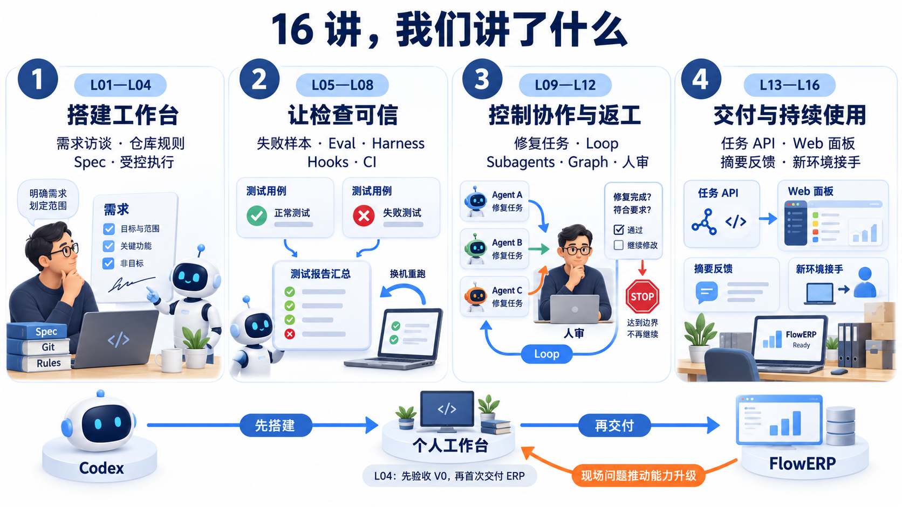
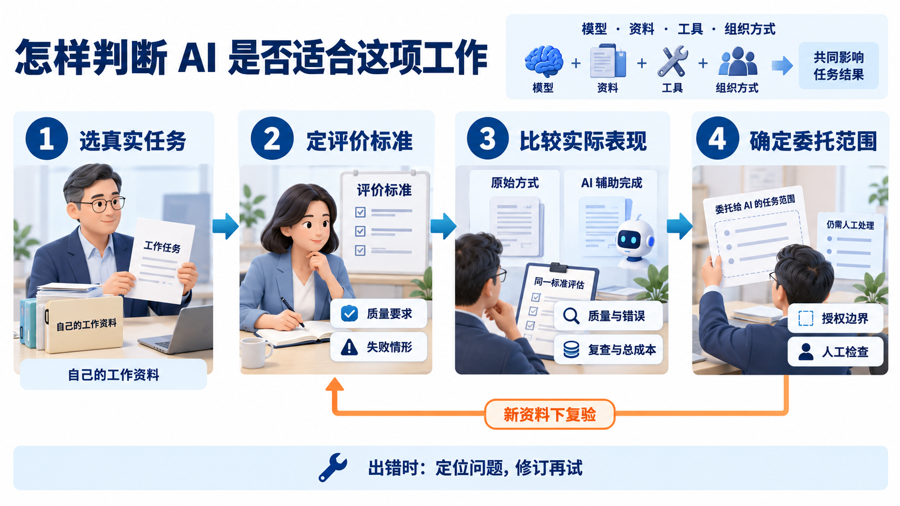
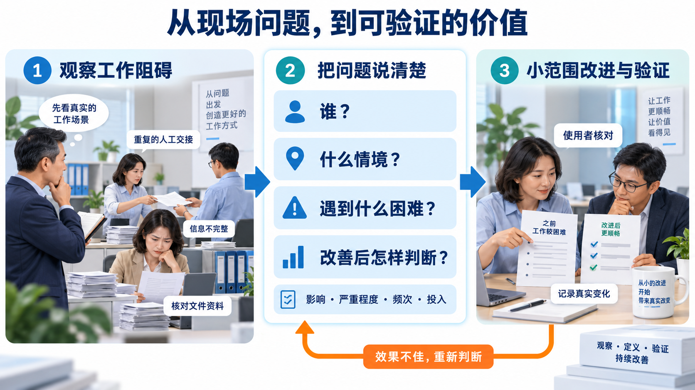
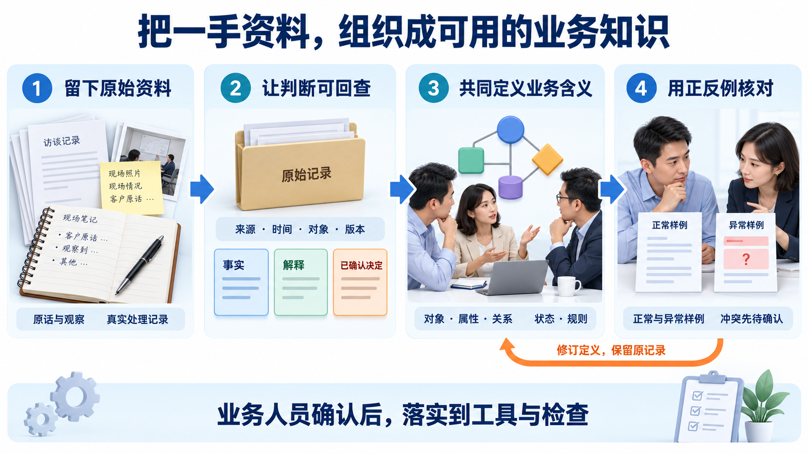
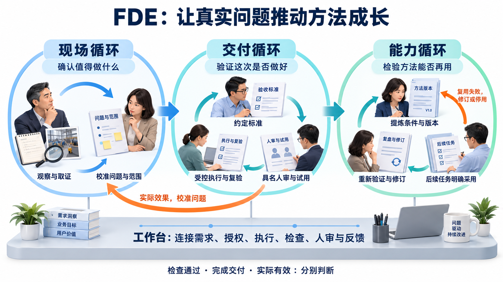
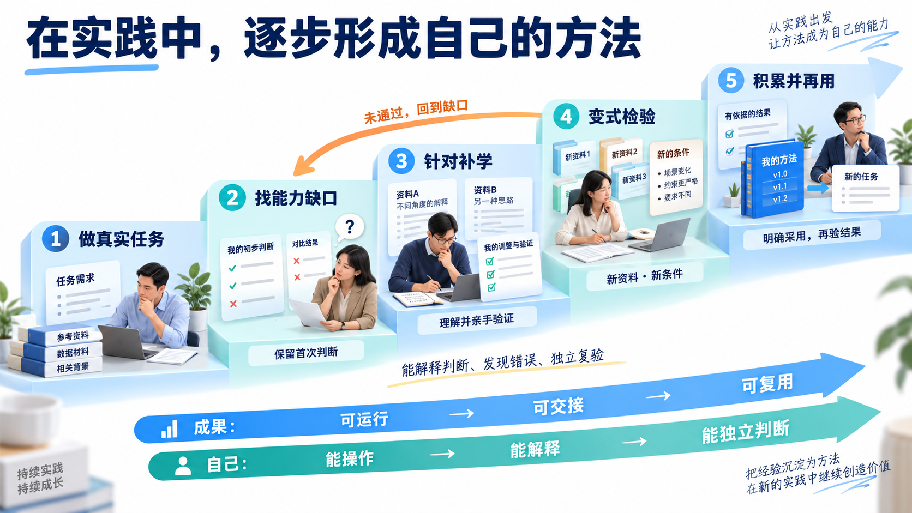

# 工作台 + FDE：解决真实问题

**主线：课程回顾（学完能带走的是什么）→ 看懂 AI 的变化 → 找准自己的价值 → 积累并组织一手资料 → 用工作台解决真实问题 → 在实践中持续学习。**

## 一、课程回顾：这门课讲了什么

通过 16 讲，我们学习了如何**把真实问题变成需求，用工作台组织人与 Codex 协同交付，再用实际结果完善方法**。

前四讲建设工作台，L04 先验收 Workbench V0，再由它组织首次 FlowERP 交付；后十二讲围绕业务问题完善检查、返工、分工、人审与反馈。

课程希望我们带走：**个人工作台、通过它持续开发的 FlowERP，以及从现场问题走向可验证交付的方法。** 个人完成情况按 L16 要求核对。

结课后继续沿用一条方法主线：**从真实问题出发，以一手资料作依据，用明确标准检验结果，再把有效方法带入下一项工作。**

## 二、大模型进展与使用进展：发生了哪些变化

看懂 AI 的变化，先分清三个层次：

- **模型能力：** 理解文字、图像等资料，进行推理、规划与内容生成。
- **工具与环境：** 让 AI 在授权范围内读取文件、运行程序、调用系统，依据执行结果继续行动。
- **使用方式：** 从问答辅助，走向目标明确的任务委托，再走向有检查、有反馈的持续协作。

**一次任务的效果，由模型、资料、工具和组织方式共同决定。** 看进展时，要看它完成了什么任务、依赖哪些条件、怎样证明结果，再判断是否适合自己的工作。

**试用方法：选一项真实任务 → 固定资料与评价标准 → 比较质量、失败和复查成本 → 确定委托范围。** 用新资料复验后，再考虑扩大范围；出错先定位资料、需求、实现或检查的问题，修订后再试，必要时缩小委托范围。

## 三、面对这些变化，普通人的价值在哪里

**价值来自：找到值得解决的问题，作出有依据的判断，让改进经得起实际使用。**

先把问题写清楚：**谁，在什么情境下，遇到什么困难，改善后能观察到什么变化？** 再结合影响、严重程度、发生频次和投入，选择一个范围可控的小问题。

例如，客户反馈整理中的关键判断是：哪些属于独立反馈，哪些只是转发，以及哪些问题值得优先处理。随后请实际使用者核对：遗漏是否减少，复查是否更方便，投入是否值得。

**一次小改进被实际使用并得到验证，才能成为自己的价值证据。**

## 四、怎样构筑自己的一手资料和业务知识

### 1. 留下过程，让判断能够回查

积累四类材料：**原始记录、本人判断、失败样例、结果与反馈。** 每条注明来源、时间、对应对象、版本和使用范围，保留修订前后的差异。

将事实、解释和已确认的决定分开。例如，客户原话是一条记录；“这些描述由同一原因造成”是需要验证的解释；处理口径则需要业务人员确认。

### 2. 用业务本体，组织共同的含义

这里借用本体建模的方法：**共同定义业务中的对象、属性、关系、状态与规则，为人、AI 和程序提供可核对的业务定义。**

从一个任务需要的少量对象开始。例如，反馈由哪位客户提出、涉及什么产品、对应哪份原文，分别建立关联；同时说清“同一条反馈”“候选问题组”的判定规则。

用真实记录和正反例核对定义。遇到冲突就修订口径，保留原始资料；经业务人员确认后，再落实到工具和检查。**资料提供依据，本体组织含义，验证帮助纠正错误。**

## 五、怎样把这些积累用于实际工作

本课程用**现场、交付、能力三循环**组织 FDE（Forward-Deployed Engineering）实践，持续解决真实问题。

- **现场循环——确认值得做什么。** 观察实际工作，收集一手资料，与使用者校准问题、范围和预期变化。
- **交付循环——验证这次是否做好。** 先约定正常与失败情形的验收标准，再限定范围执行、独立复验、具名人审，并在获准试用后收集效果。
- **能力循环——检验方法能否再用。** 从真实结果和失败中提炼方法，注明适用条件、版本和审核人；在后续任务中明确采用、重新验证，失效时修订或停用。

工作台把需求、授权、执行、检查、人审与反馈连在一起，让上述判断有记录可查。

**检查通过、完成交付、实际有效，要分别判断。** 测试检查约定行为，交付核对约定成果，实际效果结合使用记录、前后变化和使用者反馈判断；方法是否可复用，还要经过下一项任务检验。

## 六、结课后怎样继续学习和成长

**以真实任务安排学习：做任务 → 找缺口 → 针对补学 → 变式检验 → 积累并再用。**

- **先判断，再求助：** 写下自己的理解、预期结果和不确定处，再让 AI 解释、示范、比较方案。
- **带着问题补学：** 每次补齐一个具体缺口，亲手修改和验证，留下首次判断、失败与修订记录。
- **换条件检验：** 换资料、换限制，检查自己能否解释关键判断、发现错误并独立复验。失败时回到缺口继续学。
- **在下一项任务中再用：** 明确采用哪份资料、哪个方法版本，记录新结果，据此更新自己的方法。

**成长看两条线：成果从可运行走向可交接、可复用；自己从能操作走向能解释、能独立判断。**
